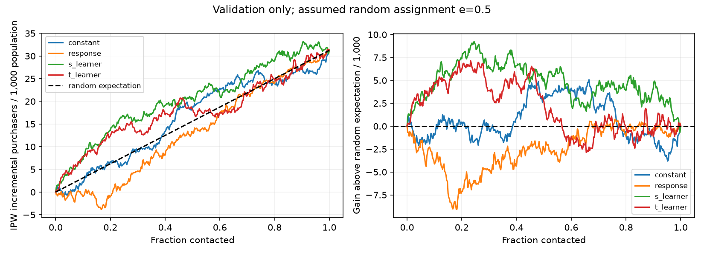
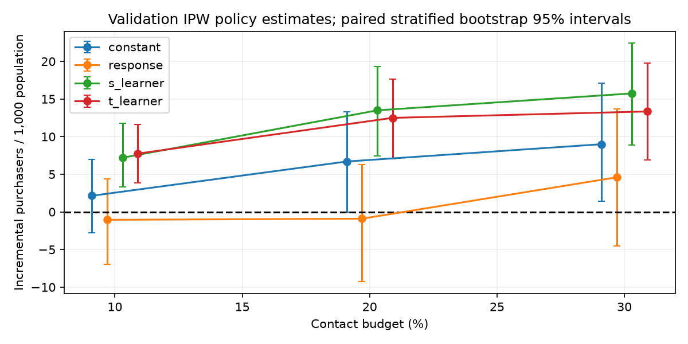

# Phase 6 — Uplift modeling and targeting-policy validation

Completed and verified for the Phase 6 completion commit on 2026-11-05. **Validation only; no final-holdout outcomes parsed or analyzed. Phase 7 has not started.**

## Decision and interpretation

The S-Learner is the strongest exploratory uplift candidate under the predeclared 30% contact-budget criterion and has the highest whole-curve point estimate. It is not yet a convincingly superior targeting policy. At 30%, its estimated incremental impact is **15.75 purchasers per 1,000 customers**, compared with **9.00** for the fixed-random policy. The paired advantage is **6.75 per 1,000**, with 95% interval **[−3.13, 15.65]**. The advantage over response-propensity targeting is **11.15 per 1,000**, interval **[−0.55, 23.30]**. Both comparisons include zero.

Following the criterion written before validation outcomes were opened, the cautious recommendation for a subsequent final evaluation is therefore the **constant-uplift/fixed-random policy at the illustrative 30% budget**, with **S-Learner retained as the strongest exploratory challenger**. This is not a claim that random targeting is best in truth, nor an economic budget recommendation. The benchmark did not establish a reliable advantage sufficient to replace it. Phase 7 requires the user's review and a separate frozen evaluation plan; no final policy or holdout evaluation has been executed here.

All effect and policy-value estimates are **assumption-dependent**, especially on an unverified random-assignment interpretation and constant assignment propensity. A positive average campaign effect does not imply that we can reliably rank who benefits most.

## Phase 5 verification and commit

Before Phase 6 development, all **82 Phase 5/Module 1 tests passed**, independent training counts and the 3.3902-percentage-point difference reproduced, and Module 1's saved predictions/metrics verified unchanged. Reviewed Phase 5 source, tests, documentation, dependency pins, and small aggregate evidence were committed and pushed as **`4f27ddc120fc42f76cc2f3768df917d7f1a96c53`** (`Complete Phase 5 RetailHero experiment audit and frozen cohort design`). Local `main` matched `origin/main` and the working tree was clean before Phase 6 began.

Module 1 code, data, frozen models, and metrics were not changed or refitted. Phase 5 split membership and its ID-only Parquet SHA-256 remain unchanged: `f38834e436b38b6483af7e4adfafda695bb2ffc9a178cf050b7f6c00a1d34169`.

## Official history acquisition and evidence of timing

Source: the [official ODS.AI RetailHero data page](https://ods.ai/competitions/x5-retailhero-uplift-modeling/data), which describes `purchases.csv` as history preceding communication. Attribution: X5 Retail Group / RetailHero, hosted by ODS.AI. The same [official archive](https://storage.yandexcloud.net/datasouls-ods/materials/9c6913e5/retailhero-uplift.zip) used in Phase 5 was verified by its unchanged ETag and 625,190,754-byte size. No mirror data were substituted. The purchase member alone was downloaded via an immutable HTTP byte range and stream-decompressed in bounded chunks.

- Expanded `purchases.csv`: **4,463,775,504 bytes**.
- Compressed member: **611,056,980 bytes**, downloaded once; no whole-archive or product-file download.
- ZIP CRC-32: **`7beba56f`**, verified after decompression along with both byte counts.
- Raw SHA-256: **`a9e132e3dde95655a0074622bb93af0616b7c4f047e71c4ce7322e2fe6d262c1`**.
- Raw file: ignored `data/retailhero/raw/purchases.csv`; existing raw files were not overwritten.

See [history_acquisition.json](phase6/history_acquisition.json). The inspected material does not provide an explicit dataset reuse license, assignment protocol, customer-level treatment timestamp, or exact outcome horizon. Attribution does not confer redistribution rights; raw data remain local. The source's historical designation supports the intended pre-treatment interpretation, but the timestamps alone cannot independently prove it.

The history ends on **2019-03-18 23:40:03**, so the feature anchor is **2019-03-19 00:00:00**, exclusive, in the source's unspecified/naive time zone. This is a **proxy anchor**, not a verified campaign timestamp. Recency therefore has an unknown common offset from campaign-time recency. No 7/30-day REES46 definition is applied to RetailHero.

## Actual history audit

The file contains **45,786,568 item rows**, **400,162 customers**, and **8,045,229 distinct customer/transaction pairs**. Timestamps span **2018-11-21 21:02:33–2019-03-18 23:40:03**. There are **118 represented calendar days**, with no whole-day gaps inside that span; the first day is partial.

Explicit schema: `client_id`, `transaction_id`, `store_id`, and `product_id` are VARCHAR; `transaction_datetime` is TIMESTAMP. `regular_points_received`, `express_points_received`, `regular_points_spent`, `express_points_spent`, `purchase_sum`, `product_quantity`, `trn_sum_from_iss`, and `trn_sum_from_red` are read as DECIMAL(18,4). CSV parsing is strict; no bad rows are silently skipped. Decimal precision is explicit, and a separate raw-text check verifies that basket values used for monetary features are not changed by that cast. Duplicate checks are on these typed rows, not claimed as a byte-for-byte text comparison.

| Quality check | Actual finding |
| --- | ---: |
| Missing values in all columns except `trn_sum_from_red` | 0 |
| Missing `trn_sum_from_red` | 42,743,212 |
| Malformed customer IDs | 0 |
| History customers without a client profile | 0 |
| Client profiles without history | 0 |
| Typed exact-duplicate row excess | 0 |
| Transactions with inconsistent timestamps | 0 |
| Transactions with inconsistent stores | 0 |
| Transactions with inconsistent/missing repeated basket totals | 0 |
| Negative basket totals | 0 |
| Zero basket totals | 567 transactions / 620 item rows |
| Maximum basket total | 35,149.04 in source monetary units |
| Zero product-quantity rows | 2,707,278 |
| Negative product-quantity rows | 0 |
| Transaction IDs shared by different customers | 28 |
| Feature timestamps at/after the proxy anchor | 0 |

The key is **(client_id, transaction_id)** because transaction ID alone is not globally unique. Product rows repeat the basket total; summing it at item grain would overstate spending. All repeated totals are consistent, so one total per customer/transaction is defensible as **recorded historical basket value**, without claiming net revenue, margin, or financial ROI.

Zero product quantities have uncertain semantics. We do not infer quantities sold from them, delete the affected customers, or build quantity-based predictors. Product breadth means distinct product IDs **recorded in history**, including these rows. Points fields and `trn_sum_from_*` are excluded because their semantics and update timing are insufficiently documented; the redemption-derived field is also mostly missing.

The existing profile audit found 313 ages outside 0–120 and 536 redemption-before-issue records; redemption dates extend into November 2019. These are not silently fixed or imputed. **All profile predictors are excluded** because their pre-treatment snapshot is unverified. No demographic rule removes experimental customers. See [Phase 5](phase5_experiment_analysis.md), [history_audit.json](phase6/history_audit.json), and [additional_history_checks.json](phase6/additional_history_checks.json).

## Feature engineering and SQL stages

Exactly **eight** history-only predictors are used. No customer IDs, target values, split names, profile dates, point balances, or post-contact records enter the feature aggregation. Treatment enters only the S-Learner's explicit treatment input and the T-Learner's arm selection.

1. **Load typed history to disk.** Explicit types preserve IDs and monetary precision. DuckDB materializes a compressed local table; Python never loads the item table into pandas.
2. **Create transaction grain.** `GROUP BY client_id, transaction_id` checks distinct timestamps, stores, and basket totals, then retains one timestamp and amount per transaction. Raw rows remain immutable. No deduplication beyond natural grouping is needed because typed row duplicates are zero.
3. **Apply the time filter.** Transaction and item aggregates use timestamps strictly before the proxy anchor; boundary tests include events exactly at the anchor. This enforces the declared filter but does not prove the anchor is the treatment date.
4. **Aggregate per customer.** Transaction summaries provide frequency, spending, active dates, and latest activity. Item summaries provide distinct products/stores without counting repeated basket totals.
5. **Left join frozen assignments.** All 200,039 experimental customers remain, with 120,022 train, 40,008 validation, and 40,009 final-holdout memberships unchanged. Final-holdout features are generated without labels; the modeling loader cannot fetch that cohort. No experimental customer lacks history, and none of the eight predictors is missing in the actual table.

| Feature | Calculation within historical data | Handling and purpose |
| --- | --- | --- |
| `transaction_count` | `count(*)` over customer/transaction records | Includes zero/invalid-money activity; measures recorded shopping frequency |
| `active_shopping_days` | `count(distinct cast(ts as date))` | Measures regularity without multiplying counts by basket items |
| `distinct_products` | `count(distinct product_id)` over item rows | Assortment breadth, including IDs on zero-quantity rows |
| `distinct_stores` | `count(distinct store_id)` over item rows | Store breadth; store IDs themselves are not predictors |
| `historical_spend` | `sum(amount) FILTER (WHERE n_amounts=1 AND amount_rows=item_rows AND amount>=0)::DOUBLE` | Missing, inconsistent, or negative amounts excluded only from money; zero retained |
| `mean_transaction_value` | `avg(amount) FILTER (WHERE n_amounts=1 AND amount_rows=item_rows AND amount>=0)::DOUBLE` | Typical basket size; same monetary rules, no silent zero imputation |
| `days_since_last_purchase` | `epoch(TIMESTAMP '2019-03-19 00:00:00'-max(ts))/86400.0` | Recency relative to the documented proxy, fractional days retained |
| `transactions_per_active_day` | `transaction_count::DOUBLE/active_shopping_days` | Within-active-day intensity; not a rate per calendar day |

SQL scope: each aggregate groups by `client_id`. Transaction aggregates use one row per `(client_id, transaction_id)`, with `ts=min(transaction_datetime)`, `last_ts=max(transaction_datetime)`, `amount=min(purchase_sum)`, `n_amounts=count(distinct purchase_sum)`, `amount_rows=count(purchase_sum)`, and `item_rows=count(*)`. Both `ts` and `last_ts` must be strictly before `TIMESTAMP '2019-03-19 00:00:00'`. Item aggregates filter `transaction_datetime` strictly before that same anchor.

For each feature, pre-treatment safety is **conditional on the official history being genuinely prior to communication**. The aggregation has no outcome input. The same frozen history and common anchor are used across cohorts; only model fitting learns from training. The anchor uses unlabeled source history, not validation outcomes. Future records at/after that anchor are filtered out.

Negative/inconsistent/missing-money rules were implemented defensively and hand-tested, although none occur in the real basket totals. If all money were invalid for a customer, monetary summaries would remain missing while activity remained; HGB would handle missing values natively. No such case occurs here. All real feature values are finite and nonnegative.

Feature summaries across all 200,039 customers are label-free QA:

| Feature | Min | Median | Max | Missing |
| --- | ---: | ---: | ---: | ---: |
| `transaction_count` | 1.0000 | 15.0000 | 320.0000 | 0 |
| `active_shopping_days` | 1.0000 | 14.0000 | 115.0000 | 0 |
| `distinct_products` | 1.0000 | 62.0000 | 1,364.0000 | 0 |
| `distinct_stores` | 1.0000 | 2.0000 | 95.0000 | 0 |
| `historical_spend` | 1.0400 | 6,102.4400 | 504,490.3800 | 0 |
| `mean_transaction_value` | 1.0400 | 393.9998 | 7,694.0000 | 0 |
| `days_since_last_purchase` | 0.0281 | 4.4234 | 22.1059 | 0 |
| `transactions_per_active_day` | 1.0000 | 1.0526 | 11.6667 | 0 |

Full means and hashes are in [feature_summary.json](phase6/feature_summary.json). An independent Python scan of all 45,786,568 raw rows recomputed eight features for 12 deterministic training-only customer histories: **96 comparisons, zero mismatches**. No outcome file enters this check. See [history_verification.json](phase6/history_verification.json).

## Model definitions, configuration, and training

The [validation plan](phase6/validation_plan.json) was written before validation outcome extraction. Training completed at **2026-11-05 12:31:52 UTC**. Model, feature, plan, and training-time source hashes are recorded in [training_receipt.json](phase6/training_receipt.json). There was one fixed configuration, no hyperparameter search or validation-driven feature change.

- **Constant uplift:** the Phase 5 training difference, `0.033902075303512746`, for everyone. This has no ranking ability; a fixed label-blind tie priority supplies the random-policy benchmark.
- **Response propensity:** one model for purchase probability from history, ignoring treatment. It estimates response under the observed experiment mixture, not the benefit of an SMS.
- **S-Learner:** one response model fitted to `(X, treatment)`. Predict every validation customer with treatment set to 1 and then 0; subtract the two probabilities. It can share statistical strength across arms, but regularization may suppress treatment interactions.
- **T-Learner:** one response model fitted to 60,034 training controls, another to 59,988 training treated customers. Subtract treated-model minus control-model probabilities on the same validation features. More flexibility can introduce variance and differences caused by independent fitting noise.

All supervised fits use scikit-learn **HistGradientBoostingClassifier**: log-loss, learning rate **0.05**, **150** iterations, maximum **7** leaves and depth **3**, minimum **200** samples per leaf, L2 regularization **10**, **64** histogram bins, no class weighting, **no early stopping**, and seed **20261105**. Four supervised fits are required: response, S, control T, treated T. The response/S fits use all 120,022 training customers; each T fit uses only its own arm. No validation rows enter fitting.

Native missing handling and histogram boundaries are learned only in each fitting population; there is no external imputation or scaling. All fits have the same feature definitions and parameter settings, with S's additional binary treatment column. One CPU thread is enforced. The [official HGB documentation](https://scikit-learn.org/stable/modules/generated/sklearn.ensemble.HistGradientBoostingClassifier.html) describes its binning and missing-value support. The locked existing environment was reused; no XGBoost or Module 1 models were changed.

The response model's validation ROC-AUC is **0.7710** and AP is **0.8480**, at high purchase prevalence. These are purchase-response metrics, not individual-effect accuracy. No ground-truth individual uplift labels exist, and none were invented. S uplift predictions range **−0.00324 to +0.09657**; T predictions range **−0.08941 to +0.20309**. Negative scores are model estimates, not verified individual harm.

## Validation population, estimators, and conventions

Validation uses **40,008 customers**: **19,996 treated / 20,012 controls**. Purchasers are **12,740 treated / 12,115 controls**, with rates **63.712743% / 60.538677%**. These outcomes were first used after the plan and training artifacts were fixed.

Let `T` be treatment, `Y` binary purchase, and `e=0.5` the **assumed** assignment probability. Define `z = T*Y/e − (1−T)*Y/(1−e)` and `b = (1−T)*Y/(1−e)`. For a policy `pi(X)`:

- Estimated purchase value: `mean(b + pi*z)`.
- Estimated incremental purchase probability over contact-nobody: `mean(pi*z)`.
- Incremental purchasers per 1,000 population customers: `1000*mean(pi*z)`.

This is a Horvitz–Thompson inverse-propensity estimator, using both arms. It estimates the policy's counterfactual impact under the identification assumptions, rather than observed conversion among the people it would contact. It is not normalized within selected arms; chance arm-count imbalance can make it differ from selected-group treated/control rate differences. The all-contact HT estimate also differs slightly from the ordinary group-rate difference because the realized assignment ratio is not exactly one half. We retain the predeclared estimator rather than switching according to which result looks better.

For a descending score ranking, `G(k/N)=sum(z for top k)/N` is the cumulative incremental gain per population customer. **AUUC** is the trapezoidal integral of G over contact fraction. The reported **unnormalized Qini area** is `AUUC − G(1)/2`, the area above the random-expectation diagonal. This is an explicit IPW convention, **not** scikit-uplift's normalization by a hypothetical perfect curve. Multiplying gain/area units by 1,000 expresses incremental-purchaser units; we report table areas in probability units. No claim about an achievable perfect individual-effect ranking is made.

Tie rules: descending score, then ascending SHA-256 of `20261105:policy:client_id`, then client ID. Neither treatment nor outcome enters tie-breaking. IDs are administrative ranking ties, never model predictors. Constant scores give exactly the fixed-random policy. Its realized curve can wiggle and have nonzero Qini area; its expected diagonal has zero Qini area.

Uncertainty uses **500 paired, treatment-stratified customer bootstrap draws**, seed **20261106**. All models/policies share draws; exact top-k membership is reselected within each resample. Multiplicity weights integrate each resampled curve without constructing a huge repeated table. Models are not refitted. Intervals are 95% percentiles conditional on these fitted models and assumed assignment. They exclude training variability, cluster dependence, protocol uncertainty, and selection/multiple-comparison adjustment. Validation comparisons are exploratory; they do not replace a final independent evaluation.

## Whole-curve results

| Ranking | AUUC | 95% CI | Qini area | 95% CI |
| --- | ---: | --- | ---: | --- |
| constant | 0.016286 | [0.009630, 0.022644] | 0.000665 | [-0.003631, 0.004866] |
| response | 0.013149 | [0.005724, 0.020284] | -0.002473 | [-0.006697, 0.001968] |
| s_learner | 0.020431 | [0.014081, 0.025608] | 0.004809 | [0.000496, 0.009286] |
| t_learner | 0.017731 | [0.011712, 0.023169] | 0.002109 | [-0.002493, 0.006149] |

S has the strongest point estimates. Its Qini interval above the random-expectation diagonal is positive, offering exploratory evidence of useful ranking. However, its **paired AUUC advantage over this fixed-random ranking is 0.004144, interval [−0.001918, 0.009766]**, and its advantage over response ranking is 0.007282, interval [−0.001220, 0.015429]. These are not compelling paired superiority results. T's corresponding intervals also include zero. Do not confuse a positive curve relative to an ideal expected diagonal with a conclusive advantage over the actual comparator policy.



All curves end at the same all-contact gain, **31.244 incremental purchasers per 1,000**, because contacting everybody removes the ranking choice. The response model predicts purchases reasonably well but has the lowest uplift-ranking point estimates: likely buyers and persuadable buyers are different targets.

## Targeting-policy comparison

For 40,008 validation customers, `ceil(budget*N)` selects exactly **4,001 / 8,002 / 12,003** customers at 10% / 20% / 30%. No labels inform selection. Contact-nobody/all are separate reference policies with 0%/100% contact rates.

All values below assume `e=0.5`. The impact denominator is the **whole customer population**, not only contacted people. Value is the estimated purchase fraction under the policy.

| Ranking / budget | Contacts | IPW purchase value | Incremental / 1,000 | 95% CI / 1,000 |
| --- | ---: | ---: | ---: | --- |
| fixed-random/10% | 4,001 | 0.607778 | 2.150 | [-2.776, 6.949] |
| fixed-random/20% | 8,002 | 0.612328 | 6.699 | [-0.050, 13.279] |
| fixed-random/30% | 12,003 | 0.614627 | 8.998 | [1.421, 17.123] |
| response/10% | 4,001 | 0.604579 | -1.050 | [-6.932, 4.407] |
| response/20% | 8,002 | 0.604729 | -0.900 | [-9.279, 6.277] |
| response/30% | 12,003 | 0.610228 | 4.599 | [-4.502, 13.700] |
| s_learner/10% | 4,001 | 0.612827 | 7.199 | [3.323, 11.748] |
| s_learner/20% | 8,002 | 0.619126 | 13.497 | [7.472, 19.325] |
| s_learner/30% | 12,003 | 0.621376 | 15.747 | [8.869, 22.422] |
| t_learner/10% | 4,001 | 0.613377 | 7.748 | [3.868, 11.598] |
| t_learner/20% | 8,002 | 0.618126 | 12.498 | [7.049, 17.673] |
| t_learner/30% | 12,003 | 0.618976 | 13.347 | [6.896, 19.796] |
| none | 0 | 0.605629 | 0.000 | [0.000, 0.000] |
| all | 40,008 | 0.636873 | 31.244 | [21.996, 40.623] |



S/T each have positive estimated increments relative to contact-nobody at these budgets. That alone does not establish better targeting than a random budget allocation. At 30%, the paired intervals versus fixed-random include zero for both learners. In the predeclared rule, superiority over both fixed-random and response rankings was required before recommending a learned policy. Neither learner passes. We retain the fixed-random reference and report S as the best exploratory candidate without further tuning.

Descriptive treated-minus-control differences within the selected groups are available in [validation_summary.json](phase6/validation_summary.json), with counts and Wilson/Newcombe intervals. At 30%, they are **3.569 pp** for fixed-random, **1.871 pp** for response, **4.549 pp** for S, and **3.431 pp** for T. These describe different selected populations; their separate confidence intervals do not supply a paired policy comparison. The primary policy comparison uses the common-population IPW contributions above. No naive comparison of selected customers' overall observed purchase rates is used as policy value.

## Propensity and hypothetical-cost sensitivity

The realized validation treatment share is **0.49980004**. Using this constant as a secondary arm-normalized sensitivity gives 30%-budget impacts of **9.147 / 4.811 / 15.863 / 13.469 per 1,000** for fixed-random / response / S / T. This small change does not establish assignment validity.

The predeclared artificial stress values `e=0.45` and `e=0.55` materially change absolute estimates and some rankings. For example, S at 30% changes to **45.168** and **−13.356** per 1,000 respectively. These values are **not a confidence interval for propensity**, not claimed plausible protocol ratios, and not a remedy for confounding. They illustrate how using incorrect weights can distort conclusions. Constant-propensity sensitivity cannot test whether propensity actually varies with customer characteristics. The source protocol remains the central unresolved identification issue.

Hypothetical contact penalties are expressed in **purchase-equivalent units**, not invented SMS prices or currency. Net incremental value is `estimated incremental purchase probability − penalty*contact fraction`. At a common budget, all policies receive the same penalty, so their ranking is unchanged. An economic optimum cannot be inferred without actual costs, purchase value/margins, and business constraints.

| Policy at 30% | Penalty 0 | Penalty 0.005 | Penalty 0.01 | Penalty 0.02 |
| --- | ---: | ---: | ---: | ---: |
| constant | 8.998 | 7.498 | 5.998 | 2.998 |
| response | 4.599 | 3.099 | 1.599 | -1.401 |
| s_learner | 15.747 | 14.247 | 12.747 | 9.747 |
| t_learner | 13.347 | 11.847 | 10.347 | 7.347 |

Entries are hypothetical net purchase-equivalents per 1,000 population customers; uncertainty in the underlying effect persists. No observed revenue or profit is reported.

## Identification limits and holdout protection

A causal interpretation requires random/exchangeable treatment assignment, correct treatment measurement, positive and known assignment probabilities, comparable outcome ascertainment, no selective post-assignment filtering, and sufficiently consistent treatment without material interference. Neither similar arm sizes nor measured balance proves these conditions. The released treatment flag describes performed communication; without assignment/compliance records this is not a verified intention-to-treat effect. Household/store dependence and unknown outcome horizons add uncertainty. Individual potential-outcome differences remain unobserved.

The historical designation is the primary timing evidence. The proxy anchor and strict time predicate cannot certify absence of post-treatment source records. No client-profile or point-derived predictor was used to reduce avoidable ambiguity. These are conditional experimental benchmarks, not verified causal production improvements.

`load_cohort` rejects anything other than train/validation **before file access**. For the raw outcome source, `read_labels` first extracts the client ID and checks allowed-cohort membership; it parses treatment/target fields only for permitted IDs. Final-holdout target fields are never parsed, summarized, modeled, or used for feature/policy selection. Raw file hashing and scanning necessarily traverse source bytes; this is a procedural data-access boundary rather than encrypted custody. The 40,009 final customers' label-free features exist locally, but no final predictions or performance are generated.

## Tests, reproducibility, resource use, and files

**102 tests pass**: the previous 82 plus 20 Phase 6 tests. New tests cover transaction totals at item grain, negative/zero/inconsistent money, immutable raw data, duplicates, exact cutoff boundaries, timestamp consistency, treatment-arm fitting isolation, native train-only preprocessing, reproducible/valid predictions, final-cohort loader denial, disallowed-label parsing denial, hand-calculated IPW values and gain/Qini areas, unequal propensities, budget counts, tie rules, invalid inputs, paired bootstrap identity, and equivalence of weighted versus explicitly resampled bootstrap calculations. Previous tests cover frozen split disjointness and design integrity.

Independent real-history verification matched 96/96 values. Saved validation scores and every one of the 500 bootstrap draws reproduce **exactly** without refitting. Saved metrics, intervals, and training-time source hashes agree; see [validation_verification.json](phase6/validation_verification.json). Features, model artifacts, raw files, plan, and split are bound by SHA-256 records.

Observed main-stage resources:

| Stage | Elapsed | Process peak RSS | Resource control |
| --- | ---: | ---: | --- |
| Official history acquisition | 52.32 s | Not separately instrumented | 1 MiB compressed reads, at most 4 MiB decompression output per step |
| History audit and feature build | 164.37 s | 750.3 MiB | DuckDB 512 MB, 1 thread, maximum 8 GB spill |
| Four supervised fits | 4.37 s | 240.5 MiB | 1 thread, customer-level matrices only |
| Validation plus bootstrap/plots | 22.80 s | 164.6 MiB | 1 thread, 500 weighted customer bootstrap draws |

The DuckDB memory setting limits its managed buffer; process RSS includes other allocations and can exceed it. This remains bounded and appropriate to the 8 GB Mac. Roughly 140 GiB was free before the 4.46 GB expanded history acquisition. The history database is about 1.3 GiB; disk spill was used during audit and removed on completion. No all-event pandas load, products download, paid API, cloud service, or expensive search occurred. Bootstrap and prediction files, trained models, database, split IDs, and feature tables remain ignored under `data/retailhero/`.

Reproduction from the root using the existing environment, or an environment installed from `requirements-causal.lock`:

```bash
PYTHONPATH=src .venv/bin/python -m growthlab.retailhero.history --acquire
PYTHONPATH=src .venv/bin/python -m growthlab.retailhero.history --build
PYTHONPATH=src .venv/bin/python -m growthlab.retailhero.history_verification
# The following two commands are for a separate fresh reproduction workspace:
PYTHONPATH=src .venv/bin/python -m growthlab.retailhero.uplift --train
MPLCONFIGDIR="$PWD/data/retailhero/phase6/matplotlib" PYTHONPATH=src .venv/bin/python -m growthlab.retailhero.uplift --evaluate
# Existing completed run: verify instead of replacing trained/evaluated artifacts.
PYTHONPATH=src .venv/bin/python -m growthlab.retailhero.uplift --verify
PYTHONPATH=src .venv/bin/python -m growthlab.retailhero.validation_verification
PYTHONPATH=src .venv/bin/python -m unittest discover -s tests -v
PYTHONPATH=src .venv/bin/python -m growthlab.final_evaluation --verify-saved
```

Acquisition/build reuse verified existing local outputs. Training/evaluation refuse to overwrite their receipts. A fresh checkout contains public receipts but not local artifacts: restore exact local files or archive generated Phase 6 receipts in a separate reproduction workspace before rerunning there; preserve Phase 5 design and split IDs. Do not delete or change frozen cohort records to try alternative splits. A full repository test run also needs the existing Module 1 modeling environment; causal dependencies alone omit XGBoost.

Phase 6 files added/changed:

- `src/growthlab/retailhero/history.py`: selective history acquisition, typed audit, transaction/customer SQL.
- `src/growthlab/retailhero/history_verification.py`: independent real-history feature checks and additional key/precision QA.
- `src/growthlab/retailhero/uplift.py`: isolated training/validation loaders, four fixed benchmark definitions, policy evaluation and plots.
- `src/growthlab/retailhero/uplift_metrics.py`: documented IPW gain/policy estimators and paired bootstrap.
- `src/growthlab/retailhero/validation_verification.py`: exact score/draw reproduction without refitting.
- `tests/test_retailhero_uplift.py`: 20 focused synthetic-logic tests; synthetic records are never reported as real experiment findings.
- `requirements-causal.lock`: expanded to pin the already installed scikit-learn/plotting dependencies; Module 1's lock file is unchanged.
- This report plus small JSON evidence and two aggregate PNG figures under `docs/causal/phase6/`.

Phase 6 is complete and verified for its completion commit. Existing Module 1 and Phase 5 tracked files remain unchanged except the causal dependency lock expanded for this phase. No API, dashboard, cloud deployment, or Phase 7 final evaluation has begun. Stop here for review.
