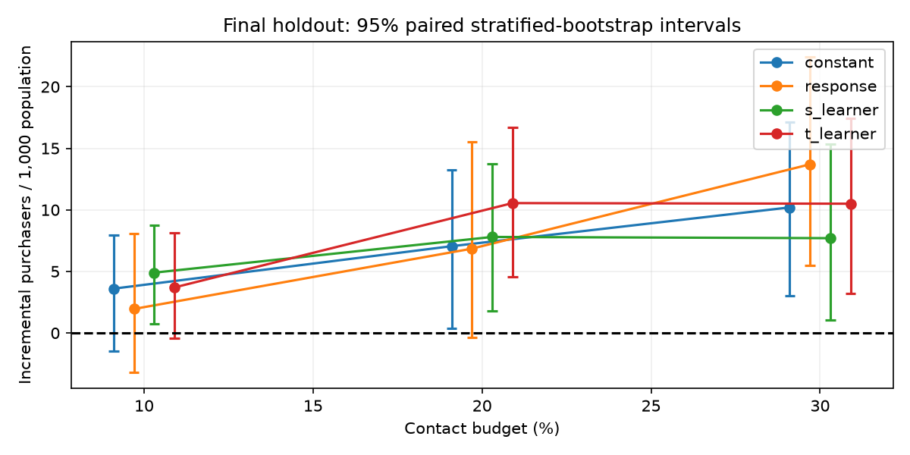
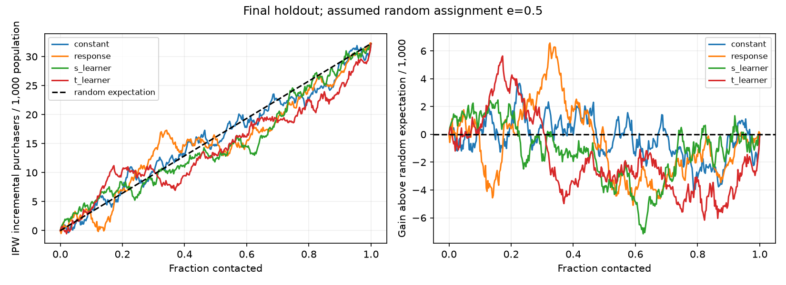

# Phase 7 — Final held-out uplift and targeting-policy evaluation

Completed locally on 2026-11-05 for review. **No Phase 7 commit or push.** This is
RetailHero Module 2; REES46 Module 1 remains a separate, unchanged predictive
study. No model was refitted, tuned, or selected using final outcomes. No new
features, algorithms, thresholds, dashboards, Docker, or deployment were added.

## Main finding

The prespecified **S-Learner minus fixed-random comparison at 30% contacts is
−2.499 incremental purchasers per 1,000 population customers**, with paired 95%
interval **[−11.850, 7.451]**. S is numerically lower than the reference, but the
interval includes zero: neither S superiority nor reference superiority is
established. We do not call this evidence that S improves targeting.

S's estimated increment is **7.698 [1.047, 15.333] per 1,000**, versus
**10.198 [3.016, 17.146]** for fixed-random. Those separate positive increments over
contact-none do not establish an advantage between the policies. The paired
comparison answers that question.

The cautious recommendation is to **retain fixed-random targeting as the
budget-matched reference**, rather than adopt any learned ranking as an established
improvement. This is not proof that random is optimal or that heterogeneous
responses are absent. If the retailer needs a practical 30% targeting benchmark,
random allocation remains a defensible comparator under the stated experiment
assumptions; a properly documented new randomized campaign would be needed before
claiming reliable operational improvements. No contact budget is financially
optimized, and no actual SMS cost, revenue, margin, or profit is inferred.

## Pre-access review and frozen protocol

Git was clean at the pushed Phase 6 commit
`ce0c851d58e5c9c783ce841f61f5851bf85423b0`; GitHub main was verified to match.
All **102 existing tests passed**. Phase 6 validation predictions and all 500
bootstrap draws reproduced exactly. Model, split, feature, and source-data hashes
verified unchanged, and Module 1's frozen evaluation verified without refitting
or new test scoring. The Phase 6 label loader permits only train/validation and
its saved prediction cohort excludes final IDs. These are procedural/code and
artifact checks, not a claim that public data have encrypted custody or that a
hash can prove nobody ever viewed a label.

The [human protocol](phase7_frozen_protocol.md) and
[machine freeze](phase7/frozen_protocol.json) were written **before** final target
extraction. The evaluator and its new tests were finished and hashed before
access. All **120 tests** passed before freezing. The independent final cohort
was already assigned in Phase 5; the official unlabeled competition test was not
used.

- Protocol frozen: **2026-11-05T14:33:59.897608+00:00**.
- Readiness recorded: **2026-11-05T14:33:59.897923+00:00**.
- One-use outcome access claimed: **2026-11-05T14:34:32.002798+00:00**.
- Evaluation completed: **2026-11-05T14:34:57.023136+00:00**.
- Frozen-protocol SHA-256: `a56005e54a3e8d18db276c095685bf5bd8db306459b7bd0a05fd127e6d96cbfd`.
- Final sorted ID/treatment SHA-256: `9801838a2b3636309dc5775af74f2c35b03da34e9111d0a07e7d1c467b929342`.

The freeze binds **41 input/implementation hashes**, including the human protocol,
new evaluator/tests, prior records and model source, the saved models, source
CSV files, customer features, frozen split assignments, and validation artifacts.
A local `final_access_ledger.json`, opened exclusively, prevents a second scoring
run. It was created before any final target parsing. This ledger must never be
deleted to retry against the evaluated cohort.

The primary challenger/reference/budget are **S / fixed-random / 30%**, with paired
S-minus-random uncertainty. Secondary analyses are T and response rankings,
10%/20% budgets, all/none references, and whole-curve comparisons. Their intervals
are exploratory and unadjusted for multiple comparisons. A numerical secondary
winner cannot become the primary model after test access.

## Population and unchanged feature/model definitions

The final cohort has **40,009 unique customers**, **19,997 treated** and **20,012
controls**, exactly matching the frozen membership. All 120,022 training and 40,008
validation IDs remain unchanged and disjoint. A full join between frozen
assignments and the Phase 6 feature table has no missing, duplicate, split, or arm
mismatches.

The eight inputs remain `transaction_count`, `active_shopping_days`,
`distinct_products`, `distinct_stores`, `historical_spend`,
`mean_transaction_value`, `days_since_last_purchase`, and
`transactions_per_active_day`; see [Phase 6](phase6_uplift_modeling.md) for exact
SQL, treatment of invalid money, and source timing. The historical anchor remains
the **2019-03-19 00:00:00 naive-time proxy**, not a verified treatment date. No
profile fields, point-derived fields, customer IDs, future outcomes, or split
names were added as predictors.

The existing saved model bundle is used unchanged (SHA-256
`36598898fcaf1aa29412ce083917d7562ba3eb68fc1d7a4dca34e4eb321a8fcb`). All four
supervised fits from Phase 6 remain HGB with 150 iterations, depth 3, maximum 7
leaves, learning rate 0.05, minimum 200 samples per leaf, L2=10, 64 bins, seed
20261105, no class weighting and no early stopping. Native missing handling and
histogram bins remain fitted to training only. S receives the binary treatment
input at prediction 1 versus 0; T uses separate saved treated/control models.
There is no new fitting step. A fit-blocking guard is active during predictions.

The constant score stays the training effect `0.033902075303512746`. Its ties are
broken by the unchanged seeded priority, producing the fixed-random comparator.
Descending score, ascending SHA-256 of `20261105:policy:client_id`, then ascending
ID define every ranking. Neither treatment nor target informs tie-breaking.

## Observed group difference versus policy estimates

In the final cohort:

| Experimental arm | Customers | Purchasers | Observed purchase rate |
| --- | ---: | ---: | ---: |
| Treated | 19,997 | 12,719 | 63.6045% |
| Control | 20,012 | 12,074 | 60.3338% |

The **observed group-rate difference is +3.2707 percentage points**, with Phase 5's
95% Wilson/Newcombe interval **[2.3196, 4.2211] pp**; the two-sided pooled test gives
p=1.6046×10⁻¹¹. This supports a nonzero association between the recorded communication
flag and purchase under the independent-observation analysis. A causal ATE reading
still depends on the original assignment/measurement assumptions. A positive
overall difference does not demonstrate that our models can rank individual
benefits.

Policy estimates use the same Horvitz–Thompson approach as Phase 6. With assumed
constant `e=0.5`, define `z=T*Y/e-(1-T)*Y/(1-e)` and `b=(1-T)*Y/(1-e)`.
For policy `pi(X)`, estimated purchase value is `mean(b+pi*z)` and estimated
increment over contact-none is `mean(pi*z)`. This combines treated and control
outcomes, rather than comparing selected customers' observed conversion rates.

These policy values are **assumption-dependent causal estimates**, not verified
causal improvements. HT estimates need not equal arm-normalized rate differences
in a finite cohort. Here contact-all is **32.243 [23.140, 42.069] additional
purchasers per 1,000**, whereas the ordinary observed group difference is 32.707;
the difference follows from fixed e=0.5 weights and unequal realized arm sizes,
not a changed outcome definition.

## Final policy-comparison table

Counts use `ceil(budget*N)`. Actual contact shares slightly exceed nominal shares:
4,001 / 8,002 / 12,003 customers correspond to **10.000250% / 20.000500% /
30.000750%**. The denominator for purchaser impact is the **entire population**,
not only contacted customers. All intervals below are paired treatment-stratified
bootstrap percentile intervals, conditional on the fitted models and e=0.5.

| Policy / nominal budget | Contact count | Actual contact % | IPW purchase value | Incremental / 1,000 | 95% CI / 1,000 |
| --- | ---: | ---: | ---: | ---: | --- |
| fixed-random/10% | 4,001 | 10.000250% | 0.607163 | 3.599 | [-1.486, 7.927] |
| fixed-random/20% | 8,002 | 20.000500% | 0.610613 | 7.048 | [0.350, 13.247] |
| fixed-random/30% | 12,003 | 30.000750% | 0.613762 | 10.198 | [3.016, 17.146] |
| response/10% | 4,001 | 10.000250% | 0.605514 | 1.950 | [-3.226, 8.074] |
| response/20% | 8,002 | 20.000500% | 0.610413 | 6.848 | [-0.355, 15.549] |
| response/30% | 12,003 | 30.000750% | 0.617261 | 13.697 | [5.468, 22.405] |
| s_learner/10% | 4,001 | 10.000250% | 0.608463 | 4.899 | [0.747, 8.727] |
| s_learner/20% | 8,002 | 20.000500% | 0.611362 | 7.798 | [1.790, 13.726] |
| s_learner/30% | 12,003 | 30.000750% | 0.611262 | 7.698 | [1.047, 15.333] |
| t_learner/10% | 4,001 | 10.000250% | 0.607263 | 3.699 | [-0.426, 8.148] |
| t_learner/20% | 8,002 | 20.000500% | 0.614112 | 10.548 | [4.573, 16.725] |
| t_learner/30% | 12,003 | 30.000750% | 0.614062 | 10.498 | [3.223, 17.449] |
| none | 0 | 0.000000% | 0.603564 | 0.000 | [0.000, 0.000] |
| all | 40,009 | 100.000000% | 0.635807 | 32.243 | [23.140, 42.069] |



Contact-all uses more contacts than any budget-limited policy. Its larger purchase
impact does not establish a better cost-aware business strategy. Conversely,
contact-none's zero increment is zero by definition; its purchase value still
reflects customers who would purchase without contact. No financial optimum can
be chosen from these binary outcomes alone.

## Paired comparisons and interpretation

All intervals below use differences within the **same bootstrap draws**, not
subtraction of separate marginal confidence limits. Positive means the first
policy has greater estimated purchase impact.

| Comparison at 30% unless stated | Difference / 1,000 | Paired 95% CI / 1,000 |
| --- | ---: | --- |
| s_learner/30% minus fixed-random/30% | -2.499 | [-11.850, 7.451] |
| s_learner/30% minus response/30% | -5.999 | [-17.327, 6.951] |
| s_learner/30% minus t_learner/30% | -2.799 | [-8.877, 3.475] |
| t_learner/30% minus fixed-random/30% | 0.300 | [-9.048, 10.174] |
| response/30% minus fixed-random/30% | 3.499 | [-5.775, 14.223] |
| s_learner/30% minus none | 7.698 | [1.047, 15.333] |
| s_learner/30% minus all | -24.544 | [-33.695, -15.794] |

Answers to the review questions:

1. **Does S outperform random numerically?** No. At the primary budget S is lower
   by 2.499 per 1,000. This is not evidence of a positive advantage.
2. **Is an advantage statistically convincing?** No. The primary interval
   [−11.850, 7.451] spans zero and permits either direction. Nor is random proven
   superior; the finding is inconclusive, not equivalence.
3. **Does S outperform response targeting?** No numerically: S is lower by 5.999
   per 1,000, with interval [−17.327, 6.951]. Response has the highest 30%-budget
   point estimate, but its advantage over random also spans zero. We do not
   promote it to the primary role after seeing final outcomes.
4. **Did T perform better or worse?** T is numerically above S by 2.799 per 1,000
   at 30%; reversing the S-minus-T interval gives [−3.475, 8.877]. The difference
   is inconclusive. T's whole-curve point estimate is slightly below S's; neither
   is a convincing ranking winner.
5. **Did this agree with validation?** It agrees with validation's lack of a
   conclusive paired superiority result. Validation's encouraging S point
   advantage did not replicate numerically at the primary budget. That sign
   reversal is compatible with the wide uncertainty; it is not by itself a
   formal test of distribution shift or evidence of an implementation error.
6. **What should the retailer cautiously prefer?** Retain fixed-random as the
   30%-budget reference. Do not sell any learned ranking as a demonstrated
   improvement. If pursuing deployment, confirm protocol/propensity and evaluate
   any future policy in a documented randomized campaign; do not tune on this
   now-consumed holdout. This does not prove random is globally optimal.
7. **What limits causal interpretation?** The source does not expose an audited
   assignment protocol, compliance logs, per-customer propensities, or outcome
   follow-up details. These estimates require exchangeability, correct treatment
   and outcome measurement, positive/known assignment probabilities, comparable
   follow-up and no selective post-assignment filtering, and no material
   interference. Similar arm counts cannot prove those assumptions.

S's positive secondary comparison with contact-none is compatible with a positive
average campaign association. It does not establish better targeting than random.
The S-minus-contact-all interval is negative, but that comparison uses different
contact resources and cannot determine net benefit without actual business costs.

## Held-out ranking curves and metrics

The metric convention is unchanged: `G(k/N)=sum_top_k(z)/N`; AUUC integrates G
against contact fraction by the trapezoidal rule. Unnormalized Qini area is
`AUUC-G(1)/2`, without any perfect-curve normalization. All rankings end at the
same contact-all gain. Constant scores yield a realized random ordering whose
curve may wiggle; its expected diagonal has zero Qini area.

| Ranking | AUUC | 95% CI | Qini area | 95% CI |
| --- | ---: | --- | ---: | --- |
| constant | 0.015850 | [0.009472, 0.022308] | -0.000272 | [-0.004897, 0.004014] |
| response | 0.015437 | [0.008881, 0.022513] | -0.000684 | [-0.004882, 0.003413] |
| s_learner | 0.014944 | [0.008980, 0.021714] | -0.001177 | [-0.005524, 0.003535] |
| t_learner | 0.014408 | [0.008230, 0.020971] | -0.001713 | [-0.006354, 0.002726] |



All final Qini intervals include zero. S-minus-random AUUC is **−0.000905**, with
paired interval **[−0.007188, 0.005732]**. S-minus-response AUUC is −0.000493,
interval [−0.008397, 0.008042]. These secondary curve results do not establish
useful ranking superiority. No individual treatment-effect labels or ordinary
classification accuracy for imagined uplift outcomes are used.

## Validation versus final holdout

| Policy at 30% | Validation incremental / 1,000 | Final incremental / 1,000 |
| --- | ---: | ---: |
| constant | 8.998 | 10.198 |
| response | 4.599 | 13.697 |
| s_learner | 15.747 | 7.698 |
| t_learner | 13.347 | 10.498 |

The primary S-minus-random difference changed from **+6.749 [−3.126, 15.649]** on
validation to **−2.499 [−11.850, 7.451]** on final holdout. Validation S Qini area
was +0.004809; final S Qini area is −0.001177. The apparent ranking promise was not
reliably confirmed. Both paired policy intervals include zero; neither cohort
justified a claim of superiority. These comparisons are descriptive; no new
cross-cohort hypothesis test, tuning step, or model-selection exercise was added.

## Propensity sensitivity and statistical limits

The final realized treated share **0.4998125422** was already known from the frozen
membership before target access. Reweighting with that constant gives 30%-budget
increments **10.337 / 13.895 / 7.808 / 10.611 per 1,000** for fixed-random /
response / S / T, respectively. The primary point ordering is unchanged. This
sensitivity does not verify that propensity was constant or exchangeable.

The unchanged illustrative stress weights e=0.45 and e=0.55 are reported below.
They are **not plausible-interval estimates for propensity**, not confidence
bounds, and not a correction for confounding. Incorrect weights can distort
absolute gains and relative ranking, particularly when policies select different
baseline response propensities.

| Assumed propensity | Fixed-random 30% | Response 30% | S 30% | T 30% |
| --- | ---: | ---: | ---: | ---: |
| 0.45 | 47.838 | 67.086 | 37.224 | 41.072 |
| 0.55 | -27.236 | -39.415 | -21.672 | -19.864 |
| 0.49981254217800997 | 10.337 | 13.895 | 7.808 | 10.611 |

Entries are incremental purchasers per 1,000 population. All budget sensitivities
and all/none estimates are retained in [final_summary.json](phase7/final_summary.json).
Changing a constant propensity cannot detect or repair customer-dependent
assignment bias.

Uncertainty preserves Phase 6's **500 paired, treatment-stratified customer
bootstrap draws, seed 20261106**, preserving each arm's count and reselecting
exact top-k per draw. Models and scores remain fixed; intervals are two-sided
95% percentiles. This quantifies cohort sampling uncertainty under the assumed
design. It excludes training uncertainty, household/store clustering,
interference, protocol uncertainty, and selection into the released sample.
Secondary intervals have no multiplicity adjustment. The primary was fixed in
advance; no threshold/model/budget was chosen from the final curves.

Other limits include unknown campaign/outcome timestamps, profile snapshot
uncertainty, the proxy history anchor, and generalization to other populations or
SMS campaigns. Each person has only one observed potential outcome. Neither a
positive average association nor a predicted individual score identifies that
person's actual causal benefit. No costs or financial returns are invented.

## Implementation, tests, and reproduction

`growthlab.retailhero.final_evaluation` is a separate final-evaluation entry point.
It preserves Phase 6's training and validation loader unchanged. `--prepare`
verifies fingerprints and label-free membership and writes the freeze/readiness
records. `--evaluate` verifies that freeze, fetches the existing final features,
claims the exclusive ledger, and only then parses targets for authorized final
IDs. It invokes the saved estimators' prediction methods under a fit-blocking
guard, reusing the unchanged Phase 6 ranking/IPW/curve/bootstrap functions.
There is no training route.

`--verify` reads saved final predictions/draws, regenerates every final statistic
and all bootstrap draws exactly, and verifies source/input hashes and chronological
freeze-before-access evidence. It never calls the outcome loader or rescores the
cohort. Hashes show unchanged files; procedural history and loader/tests provide
the evidence for prior outcome exclusion, not a claim of perfect secret custody.

**All 120 tests pass, with no skips**, both before final access and after evaluation.
The 18 new Phase 7 tests cover exact frozen cohort counts and uniqueness,
changed/overlapping assignments, no refitting and an actively blocked fit call,
fixed primary pair, exact ceiling budget counts, label-blind random ties, direct
IPW arithmetic, paired bootstrap intervals, repeatability, curve endpoints,
secondary reference/sensitivity calculations, exclusive ledger rejection, a
verification path without label loading/prediction, changed immutable hashes,
and prior artifact-state mutations. Fixtures are synthetic only for testing;
all reported results above use the real final cohort.

Saved final statistics and **all 500 bootstrap draws reproduce identically**.
All **82 pre-existing local data/artifact file states** remain unchanged, and
source/model/raw/split hashes verify. Module 1's raw sources and frozen benchmark
were independently checked in preflight; its implementation and metrics were
not modified. The original RetailHero source, split table, features, and model
bundle are unchanged. See [verification.json](phase7/verification.json).

The evaluation used **29.23 seconds**, **195.2 MiB peak process RSS**, one CPU thread, and a 256 MB DuckDB memory limit for metadata/customer-feature reads. Only customer-level matrices are fetched; no raw event table is loaded into pandas. There were no downloads or cloud resources.

The authorized one-time commands have already run:

```sh
PYTHONPATH=src .venv/bin/python -m growthlab.retailhero.final_evaluation --prepare
PYTHONPATH=src .venv/bin/python -m growthlab.retailhero.final_evaluation --evaluate
```

Do not repeat them or delete the ledger. Verify this run with:

```sh
PYTHONPATH=src .venv/bin/python -m growthlab.retailhero.final_evaluation --verify
PYTHONPATH=src .venv/bin/python -m unittest discover -s tests -v
PYTHONPATH=src .venv/bin/python -m growthlab.final_evaluation --verify-saved
```

Exact existing dependencies remain pinned in `requirements-causal.lock` and the
Module 1 modeling lock. Full local verification needs ignored local artifacts;
they are intentionally not published. A new scientific experiment would need a
new, explicitly reviewed protocol and fresh data rather than retries against this
consumed holdout.

Files added/changed:

- `src/growthlab/retailhero/final_evaluation.py`: one-use freeze/evaluation and cached verification, reusing existing estimators.
- `tests/test_retailhero_final_evaluation.py`: 18 automated tests written before access.
- `docs/causal/phase7_frozen_protocol.md`: frozen human-readable primary/secondary specification.
- `docs/causal/phase7/{frozen_protocol,readiness_receipt,final_summary,verification}.json`: small protocol/provenance/aggregate records.
- `docs/causal/phase7/figures/{uplift_qini,policy_value}.png`: aggregate final curves/intervals.
- This report and `README.md`: final verified evidence and clearly separate REES46/RetailHero studies.

New ignored artifacts are only under `data/retailhero/phase7/`: prior file-state
snapshot, one-use ledger, predictions, bootstrap draws, and plotting cache. No raw
records, customer tables, predictions, model binaries, caches, or credentials are
added to Git. Phase 5/6 source and records remain unchanged; only README changes
among previously tracked files. Nothing is staged, committed, or pushed, and HEAD
remains the approved Phase 6 commit.

## Discrepancies and next steps

The expected result was not assumed in advance. The notable empirical discrepancy
is that validation's positive S ranking signal did not replicate in the final
30%-budget comparison or Qini point estimate. No verification, membership, model,
or arithmetic discrepancy was found; all exact reproducibility checks passed.
Do not respond by tuning on final labels or claiming random is proven optimal.

Review these final findings and limitations first. After approval, save the Phase 7
work in a dedicated commit. A later GrowthLab Decision Studio can present the two
studies separately, show budget/uncertainty/assumption controls, and clearly mark
hypothetical costs. That is a recommended future development step, not work begun
here. Any further causal improvement claim should use a documented experiment
and a new independent evaluation, not this now-consumed holdout.

Stop after Phase 7. No dashboard, Docker, deployment, new feature engineering,
model experiment, or commit/push has been started.
