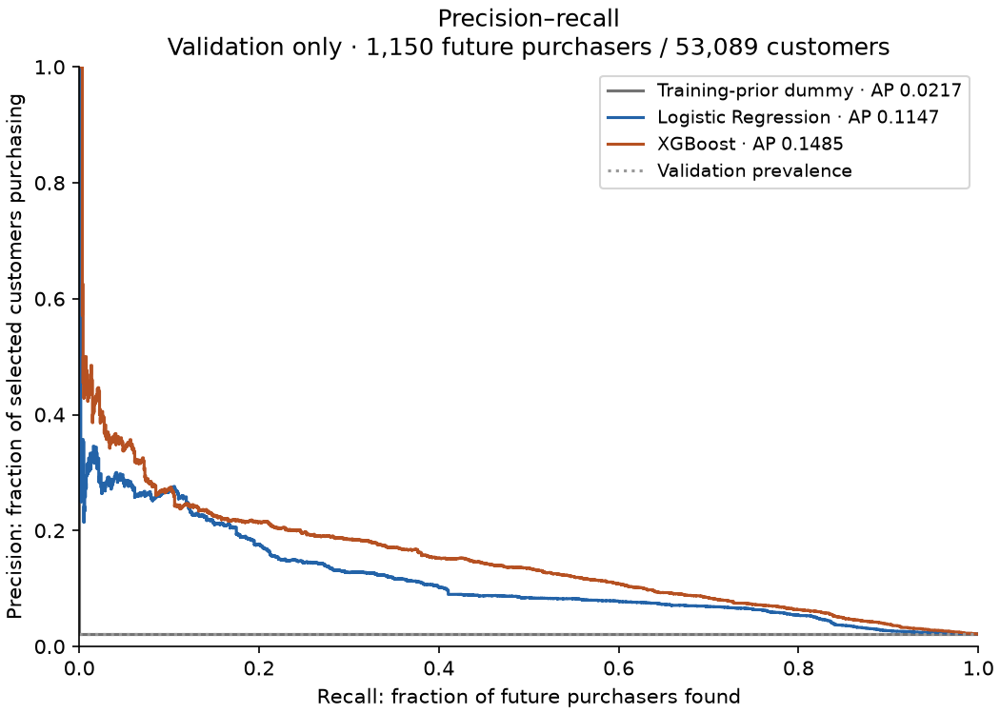
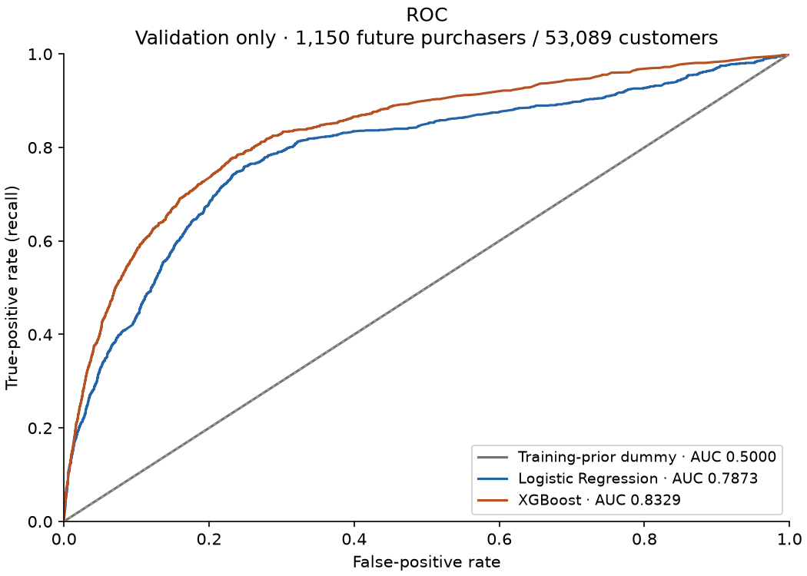
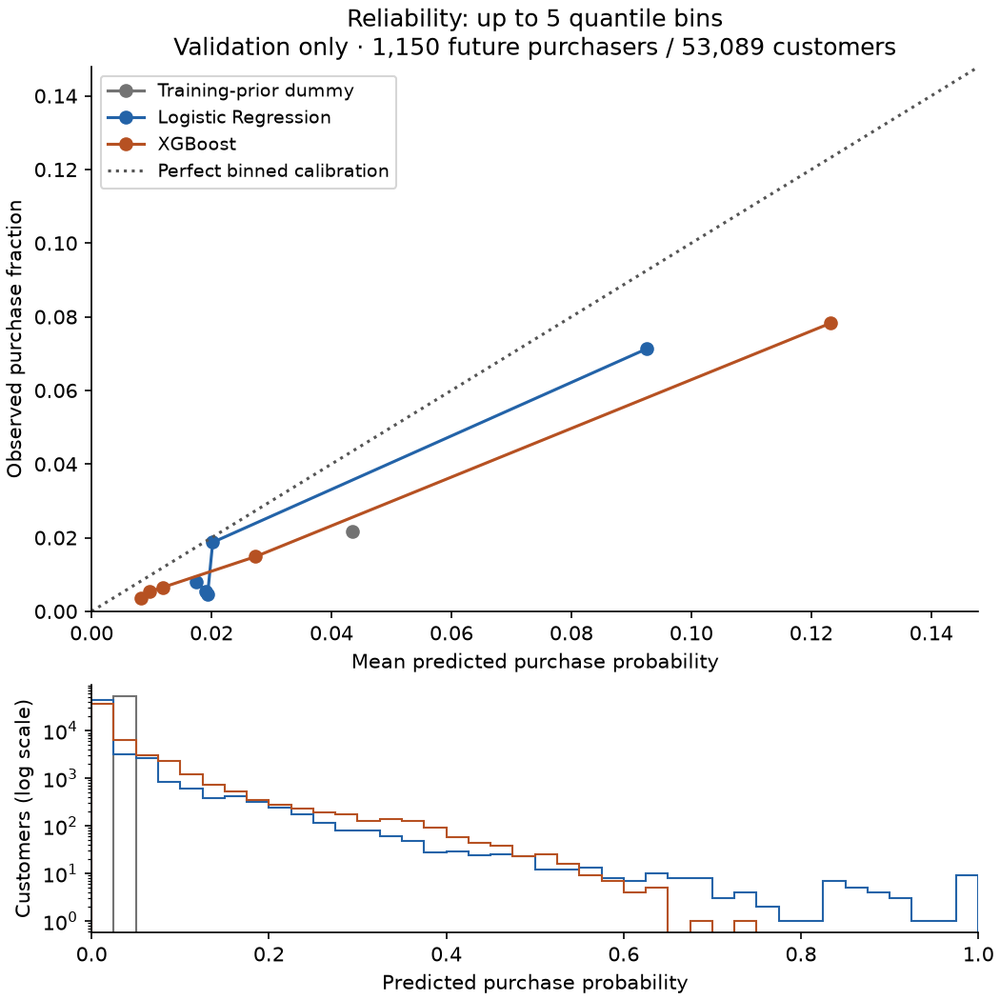
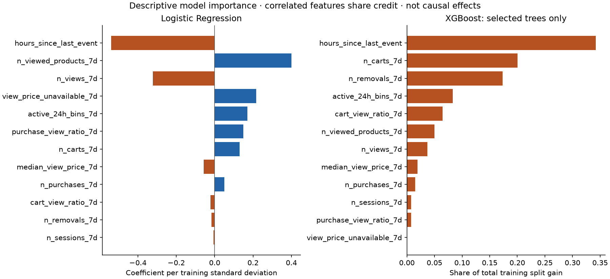

# Phase 3 — initial predictive modeling, validation only

Status: **ready for review; no test predictions or test performance computed**.
The primary twelve-feature specification and temporal splits are unchanged.
The user approved this milestone after reviewing Phase 2. Phase 3 is not committed
or pushed. This is a comparison of observed purchase predictions, not causal
marketing effects or deployment performance.

## 1. Preserving the completed work

Before modeling, the complete existing suite passed **35 tests**. All five raw
CSV sizes/hashes matched acquisition; original audit Parquet and customer-export
hashes matched their recorded versions. Historical Phase 0/1 documents and audit
JSON files matched Git. Generated datasets, virtual environments, local settings,
databases and history checks were confirmed ignored.

Only reviewed source, documentation, tests, specifications and small aggregate
evidence were staged. Two logical commits were pushed to `origin/main`:

- `4e0dbf8`: Phase 1.5 cleaning policies, chronological design and diagnostics.
- `696feae`: Phase 2 feature build, verification, specification and documentation.

The working tree was clean after those pushes. Earlier reports are historical
snapshots; their original “not committed” status describes when they were written.
No raw data, customer-level tables, predictions, model binaries or credentials
were included in either commit.

## 2. Modeling data and leakage boundary

The input is the approved primary split Parquet, not the full customer master
or broader schedule. One row is one eligible observed user ID. Inputs use
`[first_seen, first_seen + 7 days)` and the binary target records any purchase in
`[first_seen + 7 days, first_seen + 37 days)`. Integrity tests from Phase 2 already
verify these event-time boundaries; the feature builder was not rerun or changed.

Exactly these twelve input columns are projected, in this fixed order:

```text
n_views_7d
n_carts_7d
n_removals_7d
n_purchases_7d
n_viewed_products_7d
active_24h_bins_7d
n_sessions_7d
hours_since_last_event
cart_view_ratio_7d
purchase_view_ratio_7d
median_view_price_7d
view_price_unavailable_7d
```

`user_id` is a key, never an input. `purchased_next_30d` is the only target.
Timestamps, split assignments, gap flags, QA fields and future-derived values
are absent from the model matrix. First-week purchase count is allowed: it is
past behavior at scoring time, distinct from the future label. No new feature,
log transform, outlier cap, imputation flag or learned feature selection was added.

The loader requires exactly key + twelve predictors + target and orders rows
by customer key for repeatability. It constructs the input matrix from the
explicit allowlist, not by choosing all numeric columns. Source export hashes,
schema, binary labels, missingness flag and disjoint customer keys are checked.
Calling the modeling loader with `test` raises an error before file access.

### Frozen splits and class balance

All prediction-time intervals below are **UTC, end-exclusive**.

| Split | Prediction dates | Customers | Positives | Prevalence | Role in this milestone |
| --- | --- | ---: | ---: | ---: | --- |
| Train | [2019-10-08, 2019-10-13) | 87,760 | 3,814 | 4.346% | Fit model weights and preprocessing |
| Validation | [2019-11-12, 2019-11-17) | 53,089 | 1,150 | 2.166% | Compare models and early-stop XGBoost |
| Test | [2019-12-17, 2019-12-22) | 51,444 | 547 | 1.063% | Reserved; existing audit counts only |

Training labels finish before November 12; validation labels finish before
December 17. Validation-driven choices can therefore be frozen at the December
17 cutoff before a later approved test evaluation. XGBoost's selected iteration
is a validation-based choice, not something available before validation outcomes
mature. Validation results are consequently model-selection evidence, not an
unbiased final evaluation. No model is fit or recalibrated on validation here.

Test access is confined to SHA-256, schema and **user IDs only** for disjointness.
Its missingness/prevalence numbers are read from frozen Phase 2 aggregates,
not newly calculated predictions or performance. Existing integrity tests still
verify saved datasets against the master; the modeling run never trains or
scores on the master, broader schedule or test predictors.

### Missing values in every split

Counts below are confirmed against the unchanged Phase 2 artifact hashes.
Training/validation missingness is also checked directly on the loaded matrices.

| Predictor | Train missing | Validation missing | Test missing (Phase 2 audit) |
| --- | ---: | ---: | ---: |
| `n_views_7d` | 0 | 0 | 0 |
| `n_carts_7d` | 0 | 0 | 0 |
| `n_removals_7d` | 0 | 0 | 0 |
| `n_purchases_7d` | 0 | 0 | 0 |
| `n_viewed_products_7d` | 0 | 0 | 0 |
| `active_24h_bins_7d` | 0 | 0 | 0 |
| `n_sessions_7d` | 0 | 0 | 0 |
| `hours_since_last_event` | 0 | 0 | 0 |
| `cart_view_ratio_7d` | 0 | 0 | 0 |
| `purchase_view_ratio_7d` | 0 | 0 | 0 |
| `median_view_price_7d` | 2,546 (2.901%) | 1,776 (3.345%) | 1,495 (2.906%) |
| `view_price_unavailable_7d` | 0 | 0 | 0 |

An unavailable price remains missing in the source data. Actual zero prices stay
zero. The existing price-unavailable feature supplies the approved missingness
indicator, so no thirteenth predictor is generated. No contradiction with the
approved design was found.

## 3. Three initial models and why

### Training-prior DummyClassifier

`DummyClassifier(strategy='prior', random_state=42)` predicts the training
positive fraction **0.0434594348** for every validation customer. It learns no
behavioral ranking and needs no imputation. It answers: can the other models do
better than assigning everyone the same historical probability?

### Logistic Regression

The fitted pipeline is `SimpleImputer(strategy='median') -> StandardScaler ->
LogisticRegression`. Every preprocessing fit uses **training rows only**. Only
price actually needs imputation; its learned value is **5.635**. Validation
missing prices receive that same training value, not a validation statistic and
not zero. Scaling uses training means/standard deviations and makes the L2
penalty more comparable across counts, hours, prices and ratios.

Configuration: `solver='lbfgs'`, `C=1.0`, `l1_ratio=0.0` (L2), `max_iter=2000`,
`tol=1e-6`, `random_state=42`, `class_weight=None`. There was no parameter search.
L2 regularization limits coefficient growth when counts/ratios are correlated;
the model remains a useful linear, interpretable baseline. It converged in **27
iterations** with no convergence warning. The current API expresses the L2
choice through `l1_ratio=0`, avoiding the deprecated explicit penalty argument.
[Scikit-learn Logistic Regression reference](https://scikit-learn.org/stable/modules/generated/sklearn.linear_model.LogisticRegression.html).

### XGBoost

A small-depth boosted tree model can represent nonlinear recency effects and
interactions that a linear model cannot. It receives the same twelve columns,
with native NaN handling for price and no scaling or imputation. Zeros remain
actual zeros. The existing missingness indicator is still present.

One fixed configuration, chosen before inspecting validation scores:

```text
objective=binary:logistic     tree_method=hist       device=cpu
n_estimators=500 (maximum)   max_depth=3            learning_rate=0.05
min_child_weight=10         subsample=0.8           colsample_bytree=0.9
reg_lambda=5.0              reg_alpha=0.0           gamma=0.0
max_bin=128                 scale_pos_weight=1.0    n_jobs=1
random_state=42             eval_metric=logloss     early_stopping_rounds=30
```

Shallow trees, minimum leaf weight, subsampling and L2 regularization limit
complexity. Histogram training and one CPU worker keep this appropriate for
the 8 GiB Mac. Validation log loss chooses when to stop; this emphasizes
probability quality rather than optimizing a large search. Exact scikit-learn AP
is reported separately and is not substituted with XGBoost's PR-area metric.
The selected iteration is **272 zero-based: 273 trees**. Training stopped after
303 rounds, including 30 patience rounds; predictions use the selected best
iteration. Importance is calculated on those selected trees only.
[XGBoost Python API](https://xgboost.readthedocs.io/en/stable/python/python_api.html#xgboost.XGBClassifier).

### Class imbalance policy

No oversampling, SMOTE or class weighting was used. Both trained models minimize
unweighted classification losses; XGBoost's `scale_pos_weight` is explicitly 1.
Weighting positives can change learned boundaries and ranking, but also changes
the probability objective. Its outputs should not automatically be interpreted
as natural-population purchase probabilities. It would need a separate,
justified experiment and calibration assessment rather than being enabled by default.

A rule that predicts no purchases would appear accurate for about 97.83% of
validation customers purely because purchases are rare. Accuracy is therefore
not a comparison metric here. The falling split prevalences are an observed
distribution shift, not a reason to rebalance or tune using the reserved test rate.

## 4. Actual validation comparison

Every column below uses the same **53,089 validation customers and 1,150 positive
labels**. No test predictions or test metrics were generated.

| Validation metric | Training-prior dummy | Logistic Regression | XGBoost |
| --- | ---: | ---: | ---: |
| Average Precision (higher better) | 0.021662 | 0.114711 | **0.148544** |
| ROC-AUC (higher better) | 0.500000 | 0.787279 | **0.832907** |
| Brier score (lower better) | 0.021668 | 0.020955 | **0.020335** |
| Log loss (lower better) | 0.111399 | 0.096021 | **0.088916** |
| Precision at top 10% | 2.015% | 9.060% | **11.942%** |
| Recall at top 10% | 9.304% | 41.826% | **55.130%** |
| Lift at top 10% | 0.930× | 4.183× | **5.513×** |
| Positives in selected group | 107 | 481 | **634** |
| Validation positives (denominator) | 1,150 | 1,150 | 1,150 |

Top 10% means **`ceil(0.10 × 53,089) = 5,309 customers`** for every model.
Score ties use label-independent pseudorandom priorities with seed 42 after
stable customer-key ordering. This is a reproducible contact-capacity rule, not
a label-optimized threshold. The dummy cannot rank, so its selected group is an
arbitrary seeded subset; its 0.930× lift is chance variation around an expected
1×, not evidence of meaningful reverse ranking.

The full-precision values and configuration are in
[validation_summary.json](phase3/validation_summary.json).

### What the metrics mean

- **Average Precision:** summarizes purchase precision as increasingly many
  customers are selected, weighting precision by recall increments. It is not
  trapezoidal PR area or the fraction of everyone who purchases. The constant
  model's AP equals validation prevalence, 2.166%. This makes improvement over
  rare-event guessing visible. [AP definition](https://scikit-learn.org/stable/modules/generated/sklearn.metrics.average_precision_score.html).
- **ROC-AUC:** measures how often a randomly drawn purchaser ranks above a
  randomly drawn nonpurchaser, accounting for ties. XGBoost's 0.833 is not 83.3%
  precision or accuracy. With many nonpurchasers, ROC-AUC alone can obscure a
  modest precision among the customers a business can actually contact.
- **Brier score:** mean squared probability error. **Log loss** penalizes
  confident wrong probabilities strongly. Both are useful probability losses;
  neither isolates calibration from discrimination. Lower loss does not prove
  calibrated probabilities. [Calibration and proper scoring rules](https://scikit-learn.org/stable/modules/calibration.html).
- **Precision at 10%:** of selected customers, how many actually purchase?
  XGBoost gives 634/5,309 = 11.942%.
- **Recall at 10%:** of all validation purchasers, how many are selected?
  XGBoost finds 634/1,150 = 55.130%.
- **Lift at 10%:** selected purchase rate divided by overall validation purchase
  rate. XGBoost concentrates observed purchasers by 5.513×. This is predictive
  concentration, not causal marketing uplift or incremental campaign revenue.

### Does XGBoost improve the baselines?

On this validation set, yes: it improves every requested point estimate. Against
Logistic Regression, AP rises by **0.033833** (about **29.5% relative**) and the
same 5,309-customer budget captures **153 additional observed purchasers**.
The recall gain is **13.30 percentage points**. Both behavioral models provide
useful ranking relative to the constant baseline.

This is not a statistically certified or unbiased deployment improvement.
Validation was used for early stopping and model comparison; there is one short
five-day validation cohort, only 1,150 positives, and substantial temporal shift.
No confidence interval or significance claim is made. A frozen future test is
still required, and no prediction establishes an intervention's effect.

## 5. Validation charts and calibration interpretation

### Precision–recall



The dummy curve coincides with the prevalence baseline. The step direction
matches AP's recall-increment weighting; reversing the curve must not draw a
constant classifier at perfect precision. Curves were checked against that
metric convention before publication. All metrics use full predictions, not
values read from the plot.

### ROC



XGBoost generally achieves more purchaser coverage for a given false-positive
rate. The precision–recall and top-budget results supply the rare-event context
that ROC alone lacks.

### Reliability and probability distributions



Reliability uses up to **five quantile bins**. Tied probabilities remain grouped,
so bin sizes need not be equal; the dummy has one bin. Each point compares mean
prediction with observed purchase fraction. Points below the diagonal indicate
overprediction. The lower panel shows the score distribution on a log-count axis.

| Model | Mean predicted purchase rate | Observed rate | Highest probability-bin mean / observed rate |
| --- | ---: | ---: | --- |
| Dummy | 4.346% | 2.166% | One constant bin |
| Logistic Regression | 3.372% | 2.166% | 9.255% / 7.129% |
| XGBoost | 3.599% | 2.166% | 12.322% / 7.826% |

**Neither behavioral model is well calibrated on this validation cohort.**
Both overpredict in every displayed bin. XGBoost has better probability losses
and ranking, yet its average prediction is farther above prevalence than
Logistic Regression's. Those findings can coexist: better separation of buyers
and nonbuyers improves losses without eliminating probability bias.

The training purchase rate is roughly twice validation's. Prior shift, different
customer mixes, left truncation and changing behavioral relationships could
contribute; this experiment does not identify a single cause. Logistic Regression
also produces a few probabilities near 1; its raw linear relationships can
extrapolate strongly for unusually active customers. No post-hoc clipping,
class-prior correction or recalibration was applied.

Five-bin reliability does not establish calibration of individual high-score
tails, and quantile bins differ between models. Treat the chart as descriptive.
If probabilities will drive expected-value decisions, calibration needs an
explicit next-stage policy, not a claim that ranking quality solves it.

## 6. Basic model importance



Logistic Regression coefficients are per **training standard deviation**, after
training median imputation. The largest magnitudes are:

- `hours_since_last_event`: **-0.5385**; less recent activity is associated with
  lower predicted purchasing conditional on the other inputs.
- `n_viewed_products_7d`: **+0.4010**.
- `n_views_7d`: **-0.3227**.
- `view_price_unavailable_7d`: **+0.2163**.
- `active_24h_bins_7d`: **+0.1715**.

Opposite signs for views and viewed-product breadth are conditional coefficients
among correlated inputs; they do not mean browsing causes fewer purchases.
For a binary feature, one standard deviation is not a full 0-to-1 change.

XGBoost's selected-tree shares of **total training split gain** are led by
recency (**34.21%**), carts (**20.05%**), removals (**17.35%**), and active bins
(**8.28%**). Gain has no direction and depends on correlated predictors, candidate
splits and the fitted trees. The missing-price indicator has zero gain here;
that does not prove missingness is irrelevant, since native price-NaN routing
and related predictors can absorb the information. All twelve approved inputs
remain unchanged. The dummy has no feature importance.

These are descriptive model explanations, not stable causal effects or evidence
that contacting a customer changes purchasing. No importance-based feature
selection was performed on validation or test.

## 7. Tests, artifacts, environment, and resource use

The complete suite passes **53 tests**, including the 35 preserved tests and
18 modeling checks. New checks cover the model test-loader barrier, actual
three-way key disjointness, exclusion of IDs/target/QA fields, fixed feature order,
masked/nullable prices, training-only imputer/scaler state, deterministic fits,
valid probabilities, known AP/ROC/Brier/log-loss/top-budget examples, undefined
one-class ROC, tie handling, reliability bins, source/artifact fingerprints and
validation-only saved results. All saved models reproduce their validation
probabilities exactly after reloading. No Logistic Regression convergence
warning or model-training warning occurred.

The model runner is [`modeling.py`](../src/growthlab/modeling.py); plotting is
[`model_plots.py`](../src/growthlab/model_plots.py). Model artifacts and generated
customer-level validation predictions live only under ignored `data/models/phase3/`:

- `dummy.joblib`, `logistic_regression.joblib` and `xgboost.ubj`.
- `validation_predictions.npz`, with validation customer keys, target and three
  probability vectors. No test prediction artifact exists.
- Local `manifest.json`, logs, scratch/cache directories and dependency provenance.

Only small aggregate evidence and four publication figures live in `docs/phase3/`.
All generated feature-export hashes still match Phase 2 after modeling. Model
serialization is for these locally generated trusted artifacts, not arbitrary
downloaded pickle files.

### Installation issue and resolution

The Mac initially lacked the native OpenMP runtime needed to load XGBoost.
Homebrew's default route began an unrelated eight-worker CMake upgrade; it was
stopped. Narrower attempts could not build in this older macOS/Homebrew setup.
No compiler/OS upgrade was completed; the existing CMake remained 4.4.3.

A **282,919-byte** Apple Silicon conda-forge LLVM OpenMP 20.1.8 package was
checksum-verified and only its runtime/license files were extracted inside the
ignored `.venv/native/`. It supports macOS 11 or newer and carries
Apache-2.0 WITH LLVM-exception. The archive SHA-256 is
`09585f9d532eab024b0cb17b0797a6b4c381ee1f4e8643a2068b511caf843796`.
[Publisher package metadata](https://api.anaconda.org/release/conda-forge/llvm-openmp/20.1.8).
[`openmp_runtime.py`](../src/growthlab/openmp_runtime.py) makes this optional
workaround reproducible and verifies the runtime before preloading it. Modeling
does not automatically download dependencies or data. An initial font-cache
warning was resolved by keeping plotting caches local; all figures were inspected.

### Tested configuration and measurements

Python **3.14.7**, NumPy **2.5.4**, scikit-learn **1.9.1**, XGBoost **3.4.1**,
Matplotlib **3.11.2**, SciPy **1.18.1** and DuckDB **2.0.0**. Exact Python package
versions are in [requirements-modeling.lock](../requirements-modeling.lock);
modeling dependencies are an optional extra in `pyproject.toml`.

- Initial full training/scoring/figure run: **24.478 seconds**, including first
  plotting-cache creation. Subsequent figure-only redraws did not refit models.
- Per-model fit plus validation-scoring/metric time: dummy **0.036 s**, Logistic
  Regression **0.215 s**, XGBoost **5.381 s**. The JSON's `fit_seconds` includes
  these scoring/metric operations and is not a pure-fit benchmark.
- Peak process resident memory: **253,231,104 bytes**, about **241.5 MiB**.
- Loaded train/validation arrays including labels/keys: **14,789,145 bytes**,
  about **14.1 MiB**. No event log or master is loaded for model fitting.
- BLAS/OpenMP model operations are limited to one thread; XGBoost uses one CPU
  worker; the DuckDB input-check connection has a 256 MB limit.
- No cloud resources, paid APIs, raw-data redownload or modeling on the broader
  schedule was used.

Reproduce in the tested Python environment:

```sh
.venv/bin/python -m pip install -r requirements-modeling.lock
# Only if Apple Silicon lacks a usable OpenMP runtime; installer needs Python 3.14:
PYTHONPATH=src .venv/bin/python -m growthlab.openmp_runtime
PYTHONPATH=src .venv/bin/python -m growthlab.modeling
PYTHONPATH=src .venv/bin/python -m unittest discover -s tests -v
```

The install command fetches free libraries, not the dataset. The actual modeling
run uses existing verified local data. It overwrites only its local Phase 3 model,
validation prediction and aggregate/figure outputs, leaving Phase 2 unchanged.

## 8. Recommendation and frozen-test plan

**Recommend XGBoost as the leading ranking candidate for user review**, with
Logistic Regression retained as an interpretable reference. Do not declare a
final selected model or deployment-ready probabilities automatically. XGBoost's
validation gains are substantial point estimates, but its probabilities remain
biased upward and the same validation cohort selected its stopping iteration.

Before any test evaluation:

1. Approve the final candidate and decide whether the task is ranking at a
   contact budget or reliable probability estimation. Keep the twelve-feature
   contract, primary dates and class-weight policy frozen.
2. Freeze preprocessing, exact model artifact/configuration and selected tree
   count, dependency versions, metrics, top-10% rounding/tie policy and any
   decision threshold. Preserve validation predictions for the review record.
3. Decide explicitly whether to keep the training fit or refit using all labels
   mature at December 17; do not silently change the estimator before testing.
   The simplest next evaluation uses the saved model unchanged.
4. If calibration is requested, specify and approve it first. A calibrator fitted
   on mature validation labels at the December 17 cutoff would consume validation
   as fitting data: its validation calibration metrics would no longer be
   independent evidence. Alternatively design a separate temporal calibration
   protocol. Neither option has been implemented here.
5. Only after that freeze and explicit authorization, load the reserved primary
   test predictors, generate one final set of predictions, and report performance
   and uncertainty without choosing features, thresholds or the winning model
   from test results. Do not expand to the master or broader schedule then unless
   separately authorized.

Phase 3 stops after this validation comparison. The next action is user review;
no test prediction/evaluation, dashboard, API or causal module has been started.
