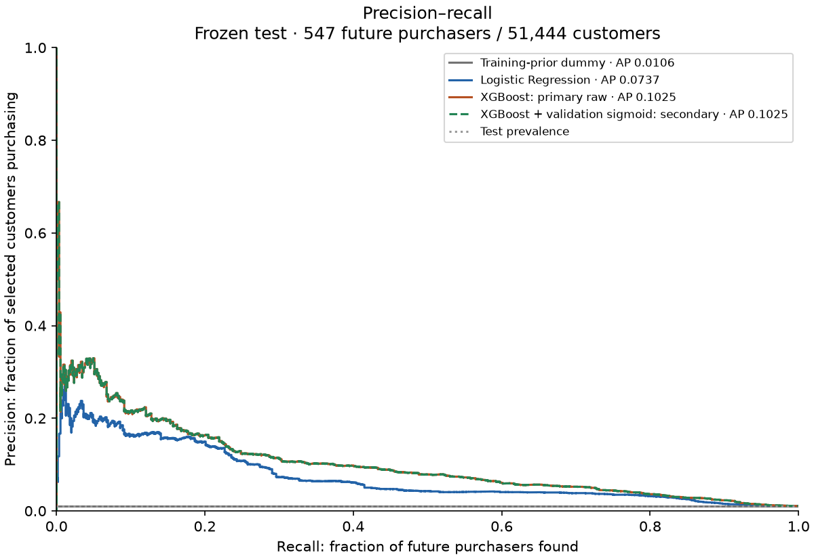
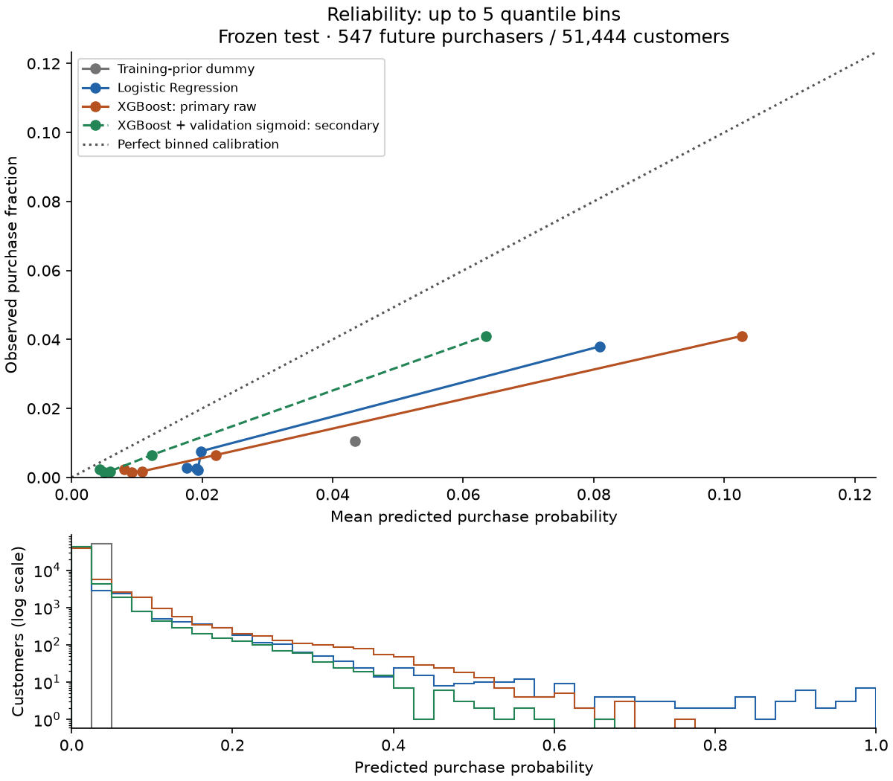

# Phase 4 — frozen test evaluation and initial release candidate

Status: **completed and verified; awaiting user review, not committed or pushed**.
Evaluation date: 2026-11-04. This is a local, reproducible initial benchmark,
not a deployed system. XGBoost was selected from validation before test scoring.
No model, feature, calibration method or split was revised after viewing test.

## 1. Findings in plain English

Early observed shopping behavior provides useful predictive ranking in this
held-out later cohort. Of **51,444 customers**, **547 purchased (1.063%)** in
their defined future window. Prioritizing the top **5,145 customers** with frozen
raw XGBoost identifies **324 purchasers: 59.23% recall, 6.30% precision and
5.92× predictive lift**. Logistic Regression identifies 243 at the same budget.

XGBoost's ranking advantage over Logistic Regression is supported by the
prespecified paired customer bootstrap, subject to its assumptions. Absolute
AP and precision fall from validation as purchase prevalence falls, while
ROC-AUC and top-budget recall improve. Do not describe every metric as unchanged.

Validation-only sigmoid calibration improves held-out Brier score by **9.45%**
and log loss by **13.39%**, without changing ranking. It does **not** make the
probabilities fully reliable: mean calibrated probability is **1.818%**, versus
**1.063%** observed. Every displayed reliability bin still overpredicts.

These are predictions of observed purchasing, **not causal uplift**. No evidence
here shows that contacting selected customers changes behavior or increases revenue.

## 2. Phase 3 verification and preservation

Before any Phase 4 model assessment, all **53 existing tests passed**. The saved
dummy, Logistic Regression and XGBoost models reproduced their exact saved
validation probabilities and every published validation metric. The Phase 3
record contained validation results only; there was no test prediction artifact.

Raw CSV sizes/SHA-256, original audit Parquet and all Phase 2 export hashes
matched their records. Historical audit files were unchanged. Only reviewed
source/tests/documentation/dependency pins and small aggregate evidence/figures
were staged; datasets, predictions, model binaries and credentials were excluded.

Phase 3 was committed and pushed as **`bbb7114`**
(`bbb71140fde22eacb1762740ce7ee2d3759f7589`). The working tree was clean and
`origin/main` matched before creating Phase 4 files. Phase 3 remains a historical
validation-only snapshot even though this later report now contains test results.

## 3. Design frozen before the test assessment

The [human-readable plan](phase4_frozen_evaluation_plan.md) was written before
test scoring. The [machine-readable plan](phase4/frozen_plan.json) binds model
configuration, seeds, source/data/artifact hashes, metrics, tie policy, missing
handling, calibration and uncertainty rules. No training+validation refit occurred.

| Item | Frozen decision |
| --- | --- |
| Primary ranking model | Saved raw XGBoost, selected iteration 272 zero-based, 273 trees used |
| Baselines | Saved training-prior DummyClassifier and Logistic Regression pipeline |
| Secondary probability variant | One validation-fitted sigmoid on raw XGBoost log-odds |
| Inputs | Same approved twelve predictors in fixed order; no keys, labels, QA/gap flags or future information |
| Feature preprocessing | Saved training-only LR median imputer/scaler; price median 5.635; XGBoost native NaNs; existing missing indicator |
| Model/random tie seed | 42 |
| Test prediction timestamps | [2019-12-17 00:00:00, 2019-12-22 00:00:00) UTC |
| Simulated evaluation cutoff | 2020-01-21 00:00:00 UTC, after all outcome windows mature |
| Contact budget | `ceil(0.10 × N)`; descending scores; seeded label-independent random priorities break ties after customer-key ordering |
| Reliability plots | Up to five quantile bins, retaining tied score groups |
| Uncertainty | 500 paired ordinary customer bootstrap resamples, seed 20261104, 95% percentile intervals |
| Revision policy | No feature/model/calibration/split changes or test-based model reselection |

The unchanged inputs are `n_views_7d`, `n_carts_7d`, `n_removals_7d`,
`n_purchases_7d`, `n_viewed_products_7d`, `active_24h_bins_7d`, `n_sessions_7d`,
`hours_since_last_event`, `cart_view_ratio_7d`, `purchase_view_ratio_7d`,
`median_view_price_7d`, and `view_price_unavailable_7d`.

Each row remains one eligible observed user ID. Inputs are strictly in the first
seven elapsed days; the label is any `purchase` in the following 30 days, with
half-open boundaries. First observed is not necessarily acquisition. All primary
test windows avoid the known January 22 gap; unknown instrumentation loss remains
an assumption. No full-master or broader-schedule model was trained or evaluated.

### Freeze sequence and outcome maturity

The plan was written at **16:37:20.385635 UTC**; the calibration completed and
the freeze receipt was written at **16:37:20.462846 UTC**, both on 2026-11-04.
The evaluator first claimed Phase 4 test-scoring access at
**16:38:14.916797 UTC**, after those records existed.

The immutable plan SHA-256 is
`70e0bfb2c66e19bdd99fec1174c8a0c5be3c2e66db4ace0791586dda8a971af6`.
[freeze_receipt.json](phase4/freeze_receipt.json) also binds the calibration
metadata and local calibrator binary before assessment. The exclusive local
access ledger prevents a second model-scoring invocation.

Before reading targets for this evaluation, metadata-only checks confirmed
51,444 unique test IDs, no train/validation ID intersection, correct split
membership and timestamps, and no gap overlaps. The first actual prediction time
is **2019-12-17 00:01:00**, the last **2019-12-21 23:57:38**. The last outcome
ends **2020-01-20 23:57:38**, before the declared January 21 cutoff. Zero calendar
or maturity errors were found. Prior audits had already checked test counts and
integrity; this is the first planned model performance assessment, not a claim
that the underlying file was never opened before.

## 4. Validation-only calibration

The base XGBoost trees were not refit. A two-parameter unweighted sigmoid was
fit only to the **53,089 frozen validation predictions and 1,150 validation
labels**, using one input: raw score log-odds. It received no customer features
or test labels. The mapping was fixed before test assessment:

```text
q = sigmoid(a × logit(clip(p, 1e-15, 1 - 1e-15)) + b)
a =  1.0196015434609753
b = -0.5261079517841346
```

This is unpenalized Logistic Regression on one score with intercept: `C=inf`,
`l1_ratio=0`, `solver=lbfgs`, `tol=1e-10`, `max_iter=1000`, seed 42, no class
weights or target smoothing. It converged in 13 iterations. The positive slope
preserves score ordering in exact arithmetic; clipping only avoids infinite
log-odds at probabilities zero/one. Actual test AP, AUC and selected top customers
are identical between the raw and calibrated variants.

The mapping mainly lowers odds, addressing the validation overprediction. That
does not guarantee it transfers to a later population. No calibrated validation
metrics are presented as independent evidence: validation already selected the
tree count and now fits this mapping. The method follows the sigmoid calibration
idea, with its exact score transformation/configuration specified above.
[Calibration background](https://scikit-learn.org/stable/modules/calibration.html).

[calibration_fit.json](phase4/calibration_fit.json) records source fingerprint,
fit counts, parameters and timestamp. Feature preprocessing remains training-only;
the explicitly authorized validation-fitted probability mapping is a separate step.

## 5. Frozen test benchmark

All variants use the same **51,444 customers / 547 positives / 1.063292% prevalence**.
Top 10% is **5,145 customers** for every variant.

| Test metric | Training-prior dummy | Logistic Regression | Raw XGBoost: primary | Calibrated XGBoost: secondary |
| --- | ---: | ---: | ---: | ---: |
| Average Precision | 0.010633 | 0.073681 | **0.102502** | **0.102502** |
| ROC-AUC | 0.500000 | 0.808121 | **0.848658** | **0.848658** |
| Brier score | 0.011597 | 0.011537 | 0.011243 | **0.010181** |
| Log loss | 0.077304 | 0.063583 | 0.057434 | **0.049743** |
| Precision at top 10% | 1.127% | 4.723% | **6.297%** | **6.297%** |
| Recall at top 10% | 10.603% | 44.424% | **59.232%** | **59.232%** |
| Lift at top 10% | 1.060× | 4.442× | **5.923×** | **5.923×** |
| Actual purchasers captured | 58 | 243 | **324** | **324** |
| Positive labels in cohort | 547 | 547 | 547 | 547 |
| Mean predicted probability | 4.346% | 3.138% | 3.058% | **1.818%** |
| Observed prevalence | 1.063% | 1.063% | 1.063% | 1.063% |

AP summarizes precision weighted by recall increments, rather than trapezoidal
PR area. ROC-AUC summarizes pairwise ranking and is not accuracy. Brier/log loss
are probability errors, lower being better. Precision counts purchasers among
selected customers; recall counts selected customers among all purchasers; lift
divides selected purchase rate by cohort prevalence. A low Brier value alone
does not establish calibration when nonpurchases dominate.

The dummy's constant probability is the **training prior**, not the test prior.
Its top group is a fixed seeded random tie selection. A 1.060× observed lift is
chance variation around an expected 1×, not learned ranking. No test-prior
baseline, probability correction, threshold optimization or alternative model
was introduced after seeing this test cohort.

Full-precision metrics, reliability bins, uncertainty, fingerprints and resource
measurements are in [test_summary.json](phase4/test_summary.json).

## 6. Validation-to-test comparison and shift

| Raw-model metric | Logistic validation | Logistic test | XGBoost validation | XGBoost test |
| --- | ---: | ---: | ---: | ---: |
| Cohort prevalence | 2.166% | 1.063% | 2.166% | 1.063% |
| AP | 0.114711 | 0.073681 | 0.148544 | 0.102502 |
| ROC-AUC | 0.787279 | 0.808121 | 0.832907 | 0.848658 |
| Precision at top 10% | 9.060% | 4.723% | 11.942% | 6.297% |
| Recall at top 10% | 41.826% | 44.424% | 55.130% | 59.232% |
| Lift at top 10% | 4.183× | 4.442× | 5.513× | 5.923× |

Raw XGBoost maintains useful separation and relative top-budget concentration:
AUC, recall and lift are higher in this later cohort. **Absolute AP and precision
are lower**. Purchase prevalence approximately halves, which changes precision
and AP even if ranking remains useful. These observations are compatible and do
not support saying performance is identical or that shift is completely solved.

Training prevalence was 4.346%, validation 2.166%, and test 1.063%. Customer mix,
seasonality, first-observation truncation and changing behavioral relationships
could all contribute. This analysis does not identify one causal source of shift.
Lower raw test losses versus validation also reflect a rarer outcome; they are
not by themselves proof of stronger calibration across cohorts.

### Precision–recall plot



The raw and calibrated XGBoost curves overlap because the sigmoid preserved
ranking. Calibration is not an additional ranking discovery or independently
selected winning model. The final primary model stays raw XGBoost as approved.

## 7. Calibration: improved losses, residual overprediction



The five-quantile-bin reliability curves compare mean probability with observed
purchase frequency. The sigmoid moves every XGBoost bin closer to the diagonal,
but all remain below it. In the highest bin, raw XGBoost predicts **10.271%**
against **4.101%** observed; the calibrated variant predicts **6.343%** for that
same ranked group. Tied-score groups are retained and bin sizes differ slightly.
The dummy has one bin. Histograms show score distributions, not validation fits.

Held-out Brier score decreases from **0.0112434 to 0.0101807** (9.45% reduction),
and log loss from **0.0574341 to 0.0497426** (13.39% reduction). The prespecified
paired intervals below support those loss improvements within this cohort.
Proper probability losses reflect more than calibration alone; here reliability
curves and mean bias also move in a favorable direction.

Residual bias is material: calibrated mean probability **1.818%** is still above
**1.063%** prevalence. Summed calibrated probabilities imply approximately
**935 purchasers**, versus **547 observed**. Calibration is therefore a partial
improvement, **not proof of reliable deployment probabilities**. Tail reliability
cannot be established from five coarse bins and 547 positives.

No test-fitted intercept, prevalence adjustment, replacement calibrator or tree
refit was attempted. Such a change would consume this test set for development
and require new independent evaluation. It is not performed here.

## 8. Uncertainty and how to read it

The frozen method uses **500 paired ordinary customer bootstrap samples**, seed
**20261104**, with 95% percentile endpoints. Each sample has N draws with
replacement; identical indices are reused across all variants. Rows are ordered
by sampled customer index before applying the fixed tie/budget policy. No base
model or calibrator is refit. All reported metrics have 500 valid resamples.
[Bootstrap mechanics and paired resampling](https://docs.scipy.org/doc/scipy/reference/generated/scipy.stats.bootstrap.html).

| Important primary-model estimate | Point estimate | Approximate 95% interval |
| --- | ---: | --- |
| AP | 0.10250 | [0.08448, 0.12633] |
| ROC-AUC | 0.84866 | [0.82849, 0.86487] |
| Precision at top 10% | 6.297% | [5.598%, 6.958%] |
| Recall at top 10% | 59.232% | [55.353%, 63.662%] |
| Lift at top 10% | 5.923× | [5.535×, 6.365×] |
| Captured purchasers at top 10% | 324 | [288, 358] |
| Raw Brier score | 0.011243 | [0.010442, 0.011953] |
| Raw log loss | 0.057434 | [0.054559, 0.060123] |

Selected prespecified paired comparisons:

| Difference | Point estimate | Approximate 95% interval | Interpretation |
| --- | ---: | --- | --- |
| XGBoost minus Logistic AP (primary contrast) | +0.028821 | [+0.017245, +0.042964] | Ranking advantage within bootstrap assumptions |
| XGBoost minus Logistic AUC | +0.040538 | [+0.025508, +0.054491] | Better pairwise separation |
| XGBoost minus Logistic recall at 10% | +14.808 pp | [+10.740 pp, +19.202 pp] | More observed purchasers captured at the same budget |
| Calibrated minus raw Brier | -0.001063 | [-0.001182, -0.000968] | Lower probability error |
| Calibrated minus raw log loss | -0.007692 | [-0.008261, -0.007177] | Lower probability loss |

Paired differences compare models on the same resampled customers; use those
intervals rather than whether two separate model intervals overlap. The complete
record also includes intervals for all baselines, mean predictions and prevalence.

These are **conditional cohort uncertainty**, not complete deployment uncertainty.
Customers are assumed independent; shared calendar/promotion effects or multiple
IDs per person can violate that assumption. Only five scoring dates are present.
Intervals omit model-training/calibration-estimation uncertainty and future
distribution shift. Percentile endpoints with 500 draws are approximate; no
p-value, simultaneous-coverage or multiple-comparison guarantee is claimed.

## 9. Business interpretation

1. **Can early activity predict later purchases?** Yes, this held-out benchmark
   shows predictive signal from the approved first-week behaviors. Raw XGBoost
   AP is 0.1025 against a constant baseline of 0.0106.
2. **Does XGBoost outperform simpler models on unseen later customers?** It
   outperforms both saved baselines on the requested point estimates. The primary
   paired AP contrast favors XGBoost under the stated uncertainty assumptions.
3. **How many purchasers can be prioritized?** The top 5,145 include 324 of 547
   observed purchasers, versus 243 for Logistic Regression: 81 more purchasers
   identified at the same selection budget. Most selected customers still do
   not purchase; about 41% of purchasers remain outside that top group.
4. **Why does imbalance matter?** Only 1.063% purchase. Accuracy and low absolute
   Brier scores can look reassuring while obscuring weak useful precision. Read
   AP, precision/recall and prevalence together. No SMOTE or class weighting was used.
5. **Are probabilities reliable?** Validation-only calibration reduces held-out
   errors, but overprediction persists overall and in every displayed bin. Use
   probability-driven expected-value decisions cautiously; ranking evidence is stronger.
6. **What are the limits?** One retailer, a short historical period, first-observed
   rather than proven-new customers, imperfect identity/price/order semantics,
   uncertain instrumentation and substantial temporal shift. This is an offline
   prediction benchmark, not evidence of incremental campaign conversions or revenue.

Predictive lift means concentration of customers who subsequently purchased
under the recorded conditions. It does not measure who would purchase *because
of* targeting. No causal inference or uplift module is implemented.

## 10. Verification, reproducibility, and resources

**66 automated tests pass**, with no skips after evaluation. The original 53
tests remain intact; 13 new tests cover calibration's validation-only fit scope,
positive monotonic score mapping, finite logits at probability boundaries,
deterministic calibration/bootstrap, no fitting during frozen prediction,
immutable plan/access ledger, fingerprint tampering rejection, metadata-only
cohort/maturity checks, fixed inputs/top-k rules, freeze-before-access ordering,
saved-metric reproduction and final population/interval consistency.

The local one-use ledger was claimed once. Metric verification afterward used
the **identical saved prediction vectors**, not a second model scoring run.
Source/model/data/calibration fingerprints still match the freeze. Raw and
Phase 2 feature artifacts were not overwritten. Logistic imputation/scaling
remains training-fitted; the two-parameter sigmoid is the only new fit and uses
validation only. Base-model and test-calibrator refit counts are zero.

Measured evaluation/scoring/500-resample/plot runtime was **94.943 seconds**.
Peak process resident memory was **203,325,440 bytes, about 193.9 MiB**. Model
and numerical work uses one worker/thread; DuckDB metadata/input checks have a
256 MB memory limit. Each bootstrap sample is processed sequentially. No full
event log is loaded into pandas, no raw data is downloaded, and no cloud or
paid service is used. Existing locked Phase 3 Python/library/OpenMP versions
are retained and verified.

### Exact files produced or modified

| File | Purpose |
| --- | --- |
| `docs/phase4_frozen_evaluation_plan.md` | Human-readable protocol fixed before scoring |
| `docs/phase4/frozen_plan.json` | Configuration, roles, seeds, metrics, method and input/model/source fingerprints |
| `docs/phase4/calibration_fit.json` | Validation-only calibration provenance and parameters |
| `docs/phase4/freeze_receipt.json` | Binding fingerprints and readiness timestamp before target access |
| `docs/phase4/test_summary.json` | Actual benchmark, intervals, calendar checks, resources and artifact fingerprints |
| `docs/phase4/figures/precision_recall.png` | Test PR curves |
| `docs/phase4/figures/calibration.png` | Test reliability and probability distributions |
| `docs/phase4_final_evaluation.md` | This final report |
| `src/growthlab/calibration.py` | Explicit validation-only sigmoid fitting/application |
| `src/growthlab/evaluation_uncertainty.py` | Fixed paired customer bootstrap and contrasts |
| `src/growthlab/final_evaluation.py` | Prepare/freeze gate, single test scoring and saved-record verification |
| `src/growthlab/final_plots.py` | Test figures; no fitting or tuning |
| `tests/test_final_evaluation.py` | Synthetic freeze/leakage tests and saved evaluation verification |
| `README.md`, `data/README.md` | Verified project status and local artifact layout |

Generated customer-level data/models stay under ignored `data/models/phase4/`:
`sigmoid_calibrator.joblib` (863 bytes), `test_predictions.npz` (701,632 bytes),
`bootstrap_draws.npz` (102,454 bytes), `test_access_ledger.json` (207 bytes), local
manifest, logs and plot caches. Existing Phase 3 model artifacts are not copied
or replaced. Published JSON/figures contain aggregate results, not customer IDs.

To verify the released record without a new test prediction:

```sh
PYTHONPATH=src .venv/bin/python -m growthlab.final_evaluation --verify-saved
PYTHONPATH=src .venv/bin/python -m unittest discover -s tests -v
```

Original execution was `--prepare`, then `--evaluate`. Both are protected against
silently replacing the freeze or repeating scoring. Do not delete the ledger to
rerun a modified experiment. A fresh reproduction from verified inputs needs a
clearly identified separate workspace/run record; this test is now an evaluated
historical benchmark and must not be reused to develop new models.

## 11. Proposed CV-ready metrics and release status

Accurate wording that preserves the study's scope:

- Built a memory-bounded customer-intelligence pipeline over **20.69 million
  e-commerce events**, with **12 time-safe first-week predictors**, explicit
  seven-day/30-day windows, chronological splits and reproducibility tests.
- Evaluated a frozen XGBoost model on **51,444 later-period held-out customers**:
  **ROC-AUC 0.849**, **AP 0.103**, identifying **324/547 future purchasers** in the
  top 10% (**59.2% recall; 5.92× predictive lift**).
- Applied validation-only sigmoid calibration, reducing held-out **Brier score
  by 9.45%** and **log loss by 13.39%**, while documenting residual overprediction
  under temporal prevalence shift.

Do not substitute validation AP 0.1485 for the held-out test result or call the
lift causal uplift, revenue growth, or a proven deployment benefit.

The initial release candidate consists of this reproducible frozen benchmark
and documentation. Phase 3 is pushed at `bbb7114`; Phase 4 remains unstaged and
uncommitted for review. No release tag, external publication/deployment, API,
dashboard, automatic model revision or causal module has been created. Stop here.
